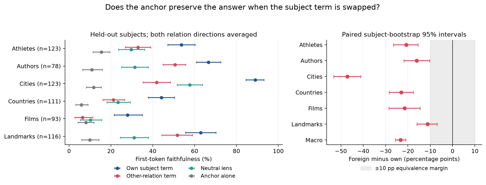

# A larger, source-checked test of anchor/subject-term swapping

**The broader interchangeability claim does not generalize to this corpus.**
Foreign relation terms retain useful subject information, but replacing the
operator's own term reduces first-token faithfulness from **57.4% to 34.1%**:
**−23.3 percentage points**, paired-bootstrap 95% CI **−25.6 to −20.9**.
The result supports partial transfer of subject information, not a clean
factorization in which the anchor alone determines the relation.

This experiment extends the same-subject design in the paper's “What the
operator's two terms carry” section. It tests `A_r + 3 T_other(e)` against
`A_r + 3 T_r(e)`, and also substitutes the relation-neutral lens `v(e)`.
It does not reproduce the exact original country capital/largest-city cohort:
the new country pair is capital/currency, and the new protocol uses fixed,
subject-disjoint references and held-out testing rather than leave-one-out
references. It therefore tests generalization under a stricter held-out design,
not whether the original small-cohort numbers were calculated correctly.



**The new triplet set.** Gemini 3.7 Flash generated 960 candidate subject pairs
using the configured Vertex project. The initial screen removed 27 pairs.
Every remaining candidate received a separate audit against fetched Wikipedia
infobox/lead evidence; author writing languages were additionally checked against
Wikidata P6886. The final corpus contains **836 subjects, 1,672 triples, and 12
domain-specific relation tasks**. Gemini performed both generation and auditing;
these are separate requests to the same model, not independent human judgments.
Source corroboration does not guarantee error-free labels.

The source gate mattered. For example, the initial self-audit accepted Bulgaria's
old currency label; the source audit rejected it. Bulgaria adopted the euro on
1 January 2026 ([European Central Bank](https://www.ecb.europa.eu/press/pr/date/2026/html/ecb.pr260101~c830245e42.en.html)).
Other exclusions include multiple legal currencies, multiple credited composers,
ambiguous names, answer-copying subjects, and unavailable source evidence.
Authors lacking sufficient language evidence were excluded rather than assigned
a language from nationality. All rejections are retained.

| Domain | Relations | Retained subjects | Held-out subjects | Distinct answers, full corpus |
|---|---|---:|---:|---|
| Athletes | Sport / main position | 155 | 123 | 8 / 55 |
| Authors | Birth city / writing language | 110 | 78 | 87 / 14 |
| Cities | Country / continent | 155 | 123 | 76 / 6 |
| Countries | Capital / currency unit | 143 | 111 | 143 / 59 |
| Films | Director / score composer | 125 | 93 | 70 / 57 |
| Landmarks | Country / city | 148 | 116 | 39 / 83 |
| **Total** | **Two relations per subject** | **836** | **644** | |

Each domain reserves 8 demonstration subjects, 8 Jacobian references, and 16
validation subjects. The remaining 644 subjects are held out from fitting and
tuning. Subjects are unique across domains. The dataset and protocol were frozen
at **2026-09-22 10:10:35 UTC**, before any new model-result file existed. “Held out”
refers to this experiment's fitting/tuning splits, not exclusion from pretraining
or all earlier experiments. No model outcome was used to add or remove subjects.
The cohort spans eight sports, fourteen writing languages, six continents for
cities, and a same-answer-type film pair. It is a curated sample of recognizable
entities, not a probability sample of world knowledge.

**Primary results.** OLMo-3-1025-7B, pinned revision
`a81bae42db3975be1671e27b9c9a56da1a9f980f`, layer 17, beta 3, float32,
eager attention, TF32 disabled. Subject strings and reference subjects are
matched between relations. Relation-specific prefixes/demonstrations can change
the subject state: this is not an identical-hidden-state experiment.
“Faithfulness” is agreement with the unmodified model's first answer token.
Rows below average the two relation directions within each subject; the final
row gives each domain equal weight.

| Domain | Own term | Foreign term | Neutral lens | Anchor alone | Foreign − own, 95% CI |
|---|---:|---:|---:|---:|---:|
| Athletes | 53.7% | 32.9% | 29.7% | 15.4% | −20.7 [−26.4, −15.4] pp |
| Authors | 66.7% | 50.6% | 31.4% | 10.9% | −16.0 [−21.8, −10.3] pp |
| Cities | 89.0% | 41.9% | 57.7% | 11.8% | −47.2 [−53.3, −41.1] pp |
| Countries | 44.1% | 21.2% | 23.4% | 5.9% | −23.0 [−28.4, −17.6] pp |
| Films | 28.0% | 6.5% | 10.2% | 8.1% | −21.5 [−28.5, −14.5] pp |
| Landmarks | 62.9% | 51.7% | 31.0% | 9.9% | −11.2 [−15.9, −6.9] pp |
| **Equal-domain average** | **57.4%** | **34.1%** | **30.6%** | **10.3%** | **−23.3 [−25.6, −20.9] pp** |

None of the six domain pairs satisfies the frozen equivalence criterion: the
90% interval for foreign-minus-own must be entirely inside ±10 points, with a
positive advantage over a wrong-subject control. All six paired mean losses have
95% intervals below zero. In directional exact McNemar tests, **11 of 12** swap
losses remain significant after Holm correction across the twelve directions.
Landmark-to-city is the exception; its own/foreign rates are 51.7%/49.1%.
Failure of equivalence is not by itself proof that every loss exceeds ten points;
the landmark interval straddles that boundary.

The strong-operator scope condition does not rescue general interchangeability.
Athletes and cities qualify using **both validation rates ≥50%**, before looking
at test outcomes. Across their 246 test subjects, own versus foreign faithfulness
is **71.3% versus 37.4%**, a **−33.9-point** gap (95% CI **−38.0 to −29.9**).
For cities specifically, both validation rates were 100%; held-out country and
continent own rates are 85.4% and 92.7%, respectively, falling to 51.2% and 32.5%
with foreign terms. Thus the main failure is not solely a floor effect in films
or another weak-operator domain. Athlete position performance drops between
validation and test, so the particularly strong case is the city pair.

**What does transfer?** The following controls establish a substantial
subject-specific signal. A matched wrong donor is another held-out subject with
different model answer tokens for both relations when available. The cyclic
control uses an outcome-independent derangement within the held-out partition.
These controls answer related but different questions, so both are reported.

| Composition / contrast | Equal-domain faithfulness or paired difference | 95% CI |
|---|---:|---:|
| Correct-subject foreign term | 34.1% | 31.7–36.6% |
| Matched wrong-subject foreign term | 3.1% | 2.2–4.1% |
| Cyclic wrong-subject foreign term | 5.3% | 4.2–6.5% |
| Foreign: correct minus matched wrong subject | +31.0 pp | +28.5 to +33.5 |
| Foreign: correct minus cyclic wrong subject | +28.8 pp | +26.3 to +31.3 |
| Correct-subject neutral lens plus anchor | 30.6% | 28.2–33.1% |
| Matched wrong-subject neutral lens plus anchor | 7.1% | 5.8–8.5% |
| Neutral lens: correct minus cyclic wrong subject | +22.1 pp | +19.8 to +24.5 |
| Neutral lens plus anchor minus anchor alone | +20.3 pp | +18.1 to +22.4 |
| Neutral lens alone | 6.3% | 5.1–7.5% |

This supports composition of subject information with a relation-dependent
anchor. It does not support “the anchor decides, not the subject term” as a
general rule. Direction matters: the author's writing-language anchor with the
birth-city term reaches 85.9% (own 94.9%), whereas the reverse birth-city query
reaches only 15.4% (own 38.5%). For city-to-continent queries with distinct model
target tokens, **53.4%** of foreign-term outputs match the source relation's
country token. The foreign term can therefore pull the output toward its own
relation, rather than merely reduce confidence in the target answer.

**Concrete examples.** These are illustrative cases selected after inspecting
outputs; all four subjects have correct model gold first tokens and successful
own operators in both directions. They are not an additional statistical sample.
Each foreign column holds the indicated target anchor fixed while inserting the
other relation's subject term. Entries are decoded first tokens, not generated
complete answers.

| Subject | Target relations | Own first tokens | Foreign first tokens |
|---|---|---|---|
| Arc de Triomphe | Country / city | France / Paris | France / Paris |
| Amsterdam | Country / continent | Netherlands / Europe | Netherlands / Netherlands |
| Dikembe Mutombo | Sport / position | basketball / center | basketball / basketball |
| Apollo 13 | Director / composer | Ron / James | James / Ron |

The film's complete dataset answers are Ron Howard and James Horner. Its swap
reverses their first-name tokens. This is a clear example of direction-specific
failure, although the film-domain operators overall are weak and do not satisfy
the strong-operator selection criterion.

**Sensitivity and scoring.** The result persists when removing easy or ambiguous
first-token cases and when selecting beta only on validation.

| Analysis | Subjects | Own | Foreign | Foreign − own, 95% CI |
|---|---:|---:|---:|---:|
| Primary, all held-out subjects | 644 | 57.4% | 34.1% | −23.3 [−25.6, −20.9] pp |
| Two different model target tokens | 628 | 57.2% | 32.8% | −24.4 [−26.7, −22.0] pp |
| Both model gold tokens correct and distinct | 476 | 61.4% | 34.8% | −26.6 [−29.4, −23.9] pp |
| Above, plus identifying gold tokens for both relations | 381 | 62.1% | 35.9% | −26.2 [−29.4, −23.1] pp |
| Validation-selected beta from 1, 2, 3, 5, 10 | 644 | 55.2% | 34.1% | −21.1 [−23.5, −18.7] pp |
| Gold first-token accuracy instead of faithfulness | 644 | 53.9% | 31.5% | −22.4 [−24.6, −20.2] pp |

The paper's original swap table scores gold first tokens; the last row is the
corresponding scoring convention here. Gold-token identification is checked
against distinct object labels in each frozen relation, not all possible world
entities. Neither that filter nor a token hit guarantees a semantically correct
complete answer. Full-model gold first-token accuracy ranges from 57.7% for
athlete positions to 100% for city countries and author writing languages.
All fixed-beta predictions remain available; no test-optimal beta is substituted.

Intervals use **20,000 bootstrap resamples of paired subjects within each
domain**, preserving both directions and all controls together. Domains receive
equal weight. They condition on this one demonstration/reference split, layer,
prompt family, donor assignment and checkpoint. They do not quantify variability
across retraining, other prompts, or untested domains. Shared answer classes and
related entities are additional potential dependencies. This is an intervention
on the affine operator's output components, not an identified internal causal
circuit or proof about isolated storage of facts.

**Suggested interpretation for the paper:**

> Cross-relation and relation-neutral subject terms retain substantial
> subject-specific information. However, their compatibility with a relation
> anchor depends strongly on the relation and transfer direction. In this
> six-domain held-out evaluation, foreign terms lose 23.3 percentage points of
> first-token faithfulness relative to the operator's own terms, including large
> losses for strong operators. These results support partial transfer rather
> than clean separation of relation and subject information between the two terms.

**Verification and Gemini usage.** Nine implementation/statistical tests passed.
All 100 planted invalid audit controls were rejected. Split, provenance, donor,
and output-completeness checks passed. Identity patches reproduce the original
vectors exactly, zero-direction JVPs are exactly zero, and the largest central
finite-difference relative discrepancy is **0.206%** across eighteen checks.
All model stages finished; none is pending.

Gemini usage: **112 returned API responses**, **1,495,398 prompt tokens**,
**135,601 answer tokens**, and **541,286 thinking tokens**; **2,172,285 total
reported tokens**. Cached-content tokens are a subset of the input accounting,
not an extra chargeable-token category to add to the total. Requests used the
existing ADC credentials and configured Vertex billing project. Actual billing
credit deductions were not queried; no dollar estimate is inferred.

Artifacts and reproduction:

- [Flattened triplets](../data/anchor_swap_gemini/triples.jsonl),
  [frozen split manifest](../data/anchor_swap_gemini/manifest.json), and
  [dataset documentation](../data/anchor_swap_gemini/README.md).
- [Frozen protocol](../data/anchor_swap_gemini/PROTOCOL.md),
  [freeze timestamp and hashes](../data/anchor_swap_gemini/FREEZE_PROVENANCE.json),
  [diversity counts](../data/anchor_swap_gemini/DIVERSITY.json), and
  [API provenance](../data/anchor_swap_gemini/API_PROVENANCE.json).
- [Every subject prediction and control](../results/anchor_swap_gemini/predictions.csv),
  [domain summary](../results/anchor_swap_gemini/domain_summary.csv),
  [all intervals and directional tests](../results/anchor_swap_gemini/summary.json),
  and [validation audit](../results/anchor_swap_gemini/validation.json).
- [Figure PDF](../results/anchor_swap_gemini/anchor_swap_results.pdf) and
  [figure SVG](../results/anchor_swap_gemini/anchor_swap_results.svg).

From `code/`, rebuild the report's numerical artifacts, validation, and plot:

```sh
.venv/bin/python scripts/report_anchor_swap_gemini.py
.venv/bin/python scripts/validate_anchor_swap_gemini.py
.venv/bin/python scripts/plot_anchor_swap_gemini.py
.venv/bin/python -m pytest tests/test_anchor_swap_report.py tests/test_paired_mechanistic.py tests/test_readout_norm.py -q
```

The dataset README gives the paid generation/auditing and GPU rerun commands.
Raw API requests/responses, source snapshots and vector tensors remain under
`generated/anchor_swap_gemini/`. Small inputs and measurements are retained under
`data/anchor_swap_gemini/` and `results/anchor_swap_gemini/`.
