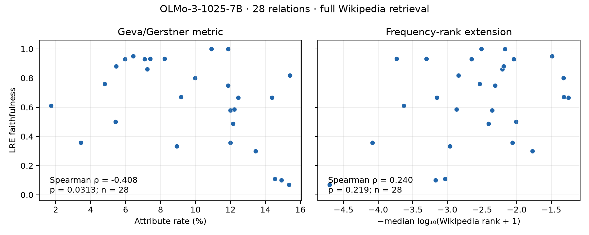

# Wikipedia baseline results (2026-09-19)

The full-corpus OLMo run is complete. The **published Geva/Gerstner attribute-rate metric** has **Spearman ρ = −0.407697 (p = 0.031277)** against LRE faithfulness across the 28 retained relations. The **frequency-ranked Wikipedia extension** has **ρ = +0.239901 (p = 0.218841)**. These are distinct scores; frequency ranking is not the metric defined in the source papers.

| Score correlated with LRE faithfulness | Spearman ρ | p (two-sided) | Pearson r | p (two-sided) |
| --- | ---: | ---: | ---: | ---: |
| Geva/Gerstner attribute rate | -0.407697 | 0.031277 | -0.394393 | 0.037819 |
| Wikipedia answer-token frequency rank (extension) | 0.239901 | 0.218841 | 0.359103 | 0.060558 |
| Matched logit-lens answer-token rank | 0.230864 | 0.237217 | 0.241178 | 0.216324 |

All three use the same 28 relations and the same retained LRE faithfulness. Higher attribute overlap does not correspond to higher faithfulness in this run: the signed correlation is negative. The frequency-rank extension uses a negative log-rank so that higher scores mean better answer-token ranks. No sign or layer was selected after seeing the results.

Across the 440 subjects with nonconstant Wikipedia token counts, mean within-subject Spearman correlation between vocabulary frequency and logit-lens logits is **0.057895** (median **0.058413**), over 89,771 eligible vocabulary tokens. The other 16 subjects have no retained paragraphs, so their vocabulary rank correlation is undefined. They are still included with zero attribute rate in the 28-relation primary result.



## Coverage and protocol

- Model: `allenai/Olmo-3-1025-7B`, revision `a81bae42db3975be1671e27b9c9a56da1a9f980f`, float32.
- Readout: hidden state 17 (block 16 output), final normalization and output head, last subject token in `{} is known for`.
- Evaluation: 513 subject-relation rows, 456 distinct subjects; no relations or rows excluded.
- Wikipedia: full October 20, 2021 dump; 21,577,582 XML pages visited, **40,284,960 nonempty cleaned paragraphs** indexed; both archive SHA-1 checksums verified.
- Retrieval: top 100 BM25 paragraphs, followed by the original subject/title filter; mean 60.636 retained paragraphs per subject, median 78.5. Sixteen subjects have none.
- Attribute readout: top 50 tokens, then the original stopword/length filtering. Corpus-side and prediction-side case handling follow upstream.

This applies the source metric to this repository’s OLMo experiment. It is not a reproduction of the source papers’ original models, known-fact subsets, prompts, or ablation curves. See the [complete method and commands](geva-baseline.md), including the query-vocabulary restriction inherited from Gerstner’s retrieval implementation.

## Validation and artifacts

- Exact agreement with BM25S on sparse scores and retrieved IDs/scores for 10,000 real Wikipedia paragraphs, 20 queries, and k = 100, plus synthetic edge cases.
- All 513 retained answer-token ranks checked: 503 exact matches; 10 one-position near-ties, largest logit gap 0.000002504. Every discrepancy is recorded. No discrepancy occurred near the top-50 cutoff for these answer tokens.
- [Retained measurements](../results/olmo/results/geva_baseline.json): relation rows, subject overlap counts, top predictions, hashes, coverage, and readout validation.
- [Source/index validation provenance](../results/olmo/results/geva_baseline_provenance.json).
- [Scatter plots (PDF)](figures/geva_baseline.pdf) and [PNG](figures/geva_baseline.png), included in this repository.
- `generated/geva_baseline/retrieval.json`: all retrieved paragraph IDs, scores, text, titles, and keep/drop decisions.
- `generated/geva_baseline/results_vocabulary.json`: ranked vocabulary with token IDs and counts for each subject.
- `/mounts/work/jonas/data/geva-wikipedia-20211020/olmo-main/`: complete corpus shards and saved BM25 index.

Recompute the correlations and plots without a model or corpus download:

```sh
uv run jlens geva-baseline report --plot-dir generated/geva_baseline
```

## Test status

All **8 new baseline tests pass**, including the retained-result regression. Lint, formatting, lockfile validation, and CPU report/plot regeneration pass. The complete repository test run finished with **105 passed and 14 failed**. The failures are in `test_matched_baseline.py` and `test_reproduction.py`: they expect the previous flat `results/` paths or a manifest matching that previous layout. The new measurement files have been added to the asset manifest; broader result-layout migration is outside this baseline change. The test log is `generated/geva_baseline/full-tests-final.log`.

## Per-relation measurements

| Relation | Rows | LRE faithfulness | Mean attribute rate (%) | Wikipedia score |
| --- | ---: | ---: | ---: | ---: |
| city_in_country | 19 | 0.818182 | 15.398657 | -2.838534 |
| company_ceo | 20 | 0.070000 | 15.340517 | -4.701263 |
| company_hq | 20 | 0.580000 | 11.995716 | -2.354541 |
| country_capital_city | 16 | 0.750000 | 11.870646 | -2.311055 |
| country_currency | 20 | 0.357143 | 11.988243 | -4.082019 |
| country_language | 16 | 1.000000 | 11.870646 | -2.171076 |
| country_largest_city | 16 | 1.000000 | 10.911731 | -2.508171 |
| landmark_in_country | 20 | 0.860000 | 7.247950 | -2.205907 |
| landmark_on_continent | 20 | 0.930000 | 7.088019 | -2.651325 |
| name_birthplace | 20 | 0.933333 | 7.408163 | -3.302340 |
| name_gender | 11 | 0.333333 | 8.929983 | -2.964731 |
| name_religion | 20 | 0.933333 | 8.234891 | -3.734504 |
| person_band_lead_singer | 13 | 0.800000 | 9.981955 | -1.322219 |
| person_father | 20 | 0.110000 | 14.534893 | -3.033288 |
| person_mother | 20 | 0.100000 | 14.918623 | -3.169161 |
| person_native_language | 20 | 0.950000 | 6.435845 | -1.491305 |
| person_occupation | 20 | 0.760000 | 4.801981 | -2.533890 |
| person_plays_instrument | 20 | 0.880000 | 5.467212 | -2.190094 |
| person_plays_position_in_sport | 20 | 0.610000 | 1.741327 | -3.630182 |
| person_plays_pro_sport | 20 | 0.930000 | 5.958719 | -2.040169 |
| person_university | 20 | 0.586667 | 12.222516 | -2.867108 |
| pokemon_evolutions | 20 | 0.357143 | 3.440663 | -2.060895 |
| presidents_birth_year | 11 | 0.666667 | 14.372895 | -3.154424 |
| presidents_election_year | 11 | 0.666667 | 12.452885 | -1.255273 |
| product_by_company | 20 | 0.670000 | 9.159652 | -1.317742 |
| star_constellation | 20 | 0.500000 | 5.422219 | -2.007847 |
| superhero_archnemesis | 20 | 0.300000 | 13.435120 | -1.770712 |
| superhero_person | 20 | 0.488095 | 12.149414 | -2.406249 |
