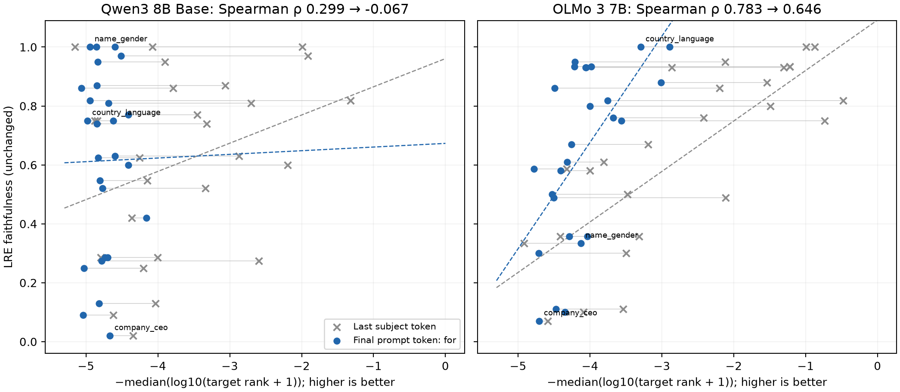

# Final-prompt-position lens versus LRE faithfulness

Measured 20 September 2026. This is a controlled **26-relation ablation** in Qwen3 8B Base and OLMo 3 7B; only `presidents_birth_year` and `presidents_election_year` are excluded. `name_gender` remains included.

## Correlations

Each point is one relation: **x = −median(log10(rank_diff + 1))**, **y = the retained LRE top-1 faithfulness**. Ranks are zero-based and targets are the model's first answer token under the original relation-specific ICL prompt. Higher x and y are better. P-values below are two-sided and test each correlation against zero; they do not test the change between correlations.

| Model | Lens input/intervention position | Spearman ρ | p | Pearson r | p |
| --- | --- | ---: | ---: | ---: | ---: |
| Qwen3 8B Base | Last subject token (retained) | 0.298768 | 0.138179 | 0.320774 | 0.1101 |
| Qwen3 8B Base | Last subject token (rerun) | 0.298768 | 0.138179 | 0.320772 | 0.110103 |
| Qwen3 8B Base | Last prompt token: `for` | -0.067077 | 0.744746 | 0.008733 | 0.966228 |
| OLMo 3 7B | Last subject token (retained) | 0.782758 | 2.29141e-06 | 0.788459 | 1.71928e-06 |
| OLMo 3 7B | Last subject token (rerun) | 0.782758 | 2.29141e-06 | 0.788459 | 1.71928e-06 |
| OLMo 3 7B | Last prompt token: `for` | 0.645912 | 0.000365077 | 0.598115 | 0.00124964 |



[PDF](last-position-lre-correlation.pdf), [all 52 relation rows as CSV](last-position-lre-correlation.csv).

## Interpretation

**Moving to `for` does not recover a positive correlation for Qwen.** OLMo retains a positive correlation, with a smaller point estimate than before. These are observed differences, not a formal test that one correlation exceeds another.

Absolute decoding also deteriorates. The table below pools the 491 scored rows per model, including the retained duplicate rows; these counts are descriptive and are not the relation-level correlation statistic.

| Model | Position | Targets in top 1 | Targets in top 10 | `-Semit` top 1 | Input-state norm range |
| --- | --- | ---: | ---: | ---: | ---: |
| Qwen3 8B Base | Last subject token | 15/491 | 48/491 | 20/491 | 94.16–11239.15 |
| Qwen3 8B Base | `for` | 0/491 | 0/491 | 0/491 | 81.09–123.82 |
| OLMo 3 7B | Last subject token | 23/491 | 101/491 | 0/491 | 2.73–25.76 |
| OLMo 3 7B | `for` | 0/491 | 3/491 | 0/491 | 17.52–21.73 |

Qwen's extreme norm disparity and repeated `-Semit` top predictions disappear, but no target reaches the top 10. For `country_language`, its median target rank worsens from 75,290.5 to 95,010.5; OLMo's worsens from 9 to 1,960.5. Removing the observed position-0 artifact is therefore insufficient to obtain a useful differential readout. OLMo's remaining correlation describes relative differences among relations despite poor absolute ranks.

## What changes

Both variants use exactly `{subject} is known for`, without an added prefix. The original variant caches h at the last subject token and differentiates the final prompt state with respect to that position. The new variant caches h at the final token `for` and differentiates with respect to that same final position. The output is still the raw final-block state at `for`.

In both cases, `v_e = mean_{i != e} J_i (h_e − h_i)`, decoded through the model's native final normalization and output head. Each Jacobian is evaluated in its reference's own prompt. We retain state 19 for Qwen and state 17 for OLMo, the first eight references among up to 20 main-protocol test subjects, and self-exclusion. We recompute both variants, rather than simply changing the readout position.

The relation-specific target prompts, target tokens and LRE y-values are fixed. We also retain duplicate rows from the original protocol: `Sofia` occurs twice among the `name_gender` references, so its two test rows each exclude both matching references and average six contributions. There is no LRE refit, layer search, beta tuning, added prefix, or normalization of the input states. This changes the representation being tested: `for` already contextualizes the subject and the suffix. It is an alternative lens definition, not proof that the original estimator is repaired. Absolute final-token indices can still vary with subject length.

## Why a large norm can be a problem

A large norm alone is not a bug: uniform rescaling can be harmless, and some large differences can still be well approximated. The observed Qwen issue is that a large **position-dependent component** dominates `h_e − h_i`. Subtracting states from different positional regimes creates a large, largely nonsemantic direction. The local derivative then extrapolates far from its reference state, and a few reference contributions dominate the average.

The earlier [implementation review](qwen3-jlens-implementation-review.md) measured this directly for Germany: with Peru as reference, the state displacement is 80.77 times the reference norm, the linear prediction has norm 7,170, and the actual full-step output change has norm 389 (relative vector error 18.26). With Australia as reference, the displacement ratio is 0.042 and the relative error is 0.046. Small-step derivative checks pass: the derivative is correct, but its finite-step extrapolation fails for those cross-position changes.

Final RMS normalization cannot undo a wrong direction: it rescales the already mixed vector. With Qwen's unbiased output head, the scalar RMS divisor cannot change token ordering. Normalizing subject states beforehand would instead change the intervention and its coordinate system; it is not an algebraically equivalent fix.

## All relation points and refitted residuals

Each model gets its own OLS fit on the 26 new x-values, with equal weight per relation. Residual = y − fitted y; a positive value means greater LRE faithfulness than the line predicts.

### Qwen3 8B Base

`ŷ = 0.673012878748 + 0.012416714773 × x`

| Relation | n | Original x | Final-position x | LRE y | Fitted y | Residual |
| --- | ---: | ---: | ---: | ---: | ---: | ---: |
| company_ceo | 20 | -4.347938 | -4.667301 | 0.020000 | 0.615060 | -0.595060 |
| person_father | 20 | -4.620965 | -5.042315 | 0.090000 | 0.610404 | -0.520404 |
| person_mother | 20 | -4.036062 | -4.817199 | 0.130000 | 0.613199 | -0.483199 |
| name_gender | 11 | -5.151600 | -4.944443 | 1.000000 | 0.611619 | +0.388381 |
| name_birthplace | 20 | -1.992489 | -4.851275 | 1.000000 | 0.612776 | +0.387224 |
| name_religion | 20 | -4.076097 | -4.597022 | 1.000000 | 0.615933 | +0.384067 |
| superhero_archnemesis | 20 | -4.200516 | -5.029739 | 0.250000 | 0.610560 | -0.360560 |
| person_plays_pro_sport | 20 | -1.915230 | -4.510298 | 0.970000 | 0.617010 | +0.352990 |
| superhero_person | 20 | -2.597462 | -4.781646 | 0.273810 | 0.613641 | -0.339831 |
| landmark_on_continent | 20 | -3.904485 | -4.836742 | 0.950000 | 0.612956 | +0.337044 |
| pokemon_evolutions | 20 | -4.003584 | -4.701151 | 0.285714 | 0.614640 | -0.328926 |
| country_currency | 20 | -4.797193 | -4.734048 | 0.285714 | 0.614232 | -0.328517 |
| person_plays_instrument | 20 | -3.062620 | -4.845650 | 0.870000 | 0.612846 | +0.257154 |
| person_native_language | 20 | -3.785382 | -5.064447 | 0.860000 | 0.610129 | +0.249871 |
| city_in_country | 19 | -1.322219 | -4.946609 | 0.818182 | 0.611592 | +0.206590 |
| star_constellation | 20 | -4.361620 | -4.157865 | 0.420000 | 0.621386 | -0.201386 |
| landmark_in_country | 20 | -2.705304 | -4.685907 | 0.810000 | 0.614829 | +0.195171 |
| person_occupation | 20 | -3.449843 | -4.410072 | 0.770000 | 0.618254 | +0.151746 |
| country_language | 16 | -4.876662 | -4.977771 | 0.750000 | 0.611205 | +0.138795 |
| country_largest_city | 16 | -4.839913 | -4.621028 | 0.750000 | 0.615635 | +0.134365 |
| person_plays_position_in_sport | 20 | -3.322126 | -4.848891 | 0.740000 | 0.612806 | +0.127194 |
| company_hq | 20 | -3.340255 | -4.770408 | 0.520000 | 0.613780 | -0.093780 |
| person_university | 20 | -4.148308 | -4.807436 | 0.546667 | 0.613320 | -0.066654 |
| person_band_lead_singer | 13 | -2.195900 | -4.408308 | 0.600000 | 0.618276 | -0.018276 |
| product_by_company | 20 | -2.873180 | -4.595726 | 0.630000 | 0.615949 | +0.014051 |
| country_capital_city | 16 | -4.253334 | -4.829306 | 0.625000 | 0.613049 | +0.011951 |

### OLMo 3 7B

`ŷ = 2.119141184980 + 0.360735716034 × x`

| Relation | n | Original x | Final-position x | LRE y | Fitted y | Residual |
| --- | ---: | ---: | ---: | ---: | ---: | ---: |
| person_mother | 20 | -4.088817 | -4.345901 | 0.100000 | 0.551419 | -0.451419 |
| person_father | 20 | -3.537122 | -4.472806 | 0.110000 | 0.505640 | -0.395640 |
| landmark_in_country | 20 | -2.196945 | -4.493515 | 0.860000 | 0.498170 | +0.361830 |
| company_ceo | 20 | -4.585583 | -4.704969 | 0.070000 | 0.421891 | -0.351891 |
| person_native_language | 20 | -2.119975 | -4.207260 | 0.950000 | 0.601432 | +0.348568 |
| name_religion | 20 | -1.219666 | -4.216832 | 0.933333 | 0.597979 | +0.335354 |
| country_currency | 20 | -4.415347 | -4.037321 | 0.357143 | 0.662735 | -0.305592 |
| name_gender | 11 | -4.918994 | -4.127947 | 0.333333 | 0.630043 | -0.296710 |
| person_plays_pro_sport | 20 | -1.305330 | -4.060335 | 0.930000 | 0.654434 | +0.275566 |
| landmark_on_continent | 20 | -2.864710 | -4.057033 | 0.930000 | 0.655624 | +0.274376 |
| name_birthplace | 20 | -1.218081 | -3.983220 | 0.933333 | 0.682251 | +0.251082 |
| pokemon_evolutions | 20 | -3.318171 | -4.288664 | 0.357143 | 0.572067 | -0.214924 |
| person_university | 20 | -4.325163 | -4.781739 | 0.586667 | 0.394197 | +0.192470 |
| person_plays_instrument | 20 | -1.539591 | -3.010505 | 0.880000 | 1.033144 | -0.153144 |
| person_band_lead_singer | 13 | -1.491362 | -4.002339 | 0.800000 | 0.675355 | +0.124645 |
| superhero_archnemesis | 20 | -3.498630 | -4.714279 | 0.300000 | 0.418532 | -0.118532 |
| product_by_company | 20 | -3.191423 | -4.256439 | 0.670000 | 0.583692 | +0.086308 |
| country_capital_city | 16 | -0.738561 | -3.561037 | 0.750000 | 0.834548 | -0.084548 |
| country_largest_city | 16 | -0.874094 | -2.893451 | 1.000000 | 1.075370 | -0.075370 |
| country_language | 16 | -0.991136 | -3.290863 | 1.000000 | 0.932009 | +0.067991 |
| city_in_country | 19 | -0.477121 | -3.754425 | 0.818182 | 0.764786 | +0.053396 |
| company_hq | 20 | -3.999305 | -4.409212 | 0.580000 | 0.528581 | +0.051419 |
| person_plays_position_in_sport | 20 | -3.809892 | -4.320222 | 0.610000 | 0.560683 | +0.049317 |
| person_occupation | 20 | -2.419399 | -3.676059 | 0.760000 | 0.793055 | -0.033055 |
| star_constellation | 20 | -3.480929 | -4.527778 | 0.500000 | 0.485810 | +0.014190 |
| superhero_person | 20 | -2.112267 | -4.505682 | 0.488095 | 0.493781 | -0.005685 |

## Validation and reproduction

- Qwen3 8B Base: 452/491 original ranks reproduced exactly; maximum rank difference 4, maximum relation-x difference 0.000144331837. 3 final-position derivative checks; worst best-step central-finite-difference relative error 0.000501593.
- OLMo 3 7B: 480/491 original ranks reproduced exactly; maximum rank difference 1, maximum relation-x difference 3.44924536e-05. 3 final-position derivative checks; worst best-step central-finite-difference relative error 0.000176779.
- All 982 target predictions are re-evaluated and checked against the frozen decoded target strings. Qwen's retained numeric token IDs also match exactly; OLMo's older snapshot stored strings only, so its re-evaluated IDs are recorded in the new evidence. Both positions use identical target IDs, subjects and reference counts.
- Every reference in both variants passes exact no-op intervention checks; captured raw final states reproduce native logits. All new cached/intervened positions equal the final prompt index and decode to `for`.
- Computation uses pinned cached checkpoints, float32 and eager attention on A100 80 GB GPUs. Input, source and dataset hashes, individual ranks/top-five tokens, state norms, and per-reference contribution norms are retained in the JSON evidence.

[Frozen input snapshot](last-position-lre-correlation-inputs.json), [complete numerical results](last-position-lre-correlation.json), [GPU runner](../../paper/repro/last_position_correlation.py), [CPU report generator](../../paper/repro/report_last_position_correlation.py).

```sh
cd code
CUDA_VISIBLE_DEVICES=0 uv run --extra gpu python ../paper/repro/last_position_correlation.py --model qwen
CUDA_VISIBLE_DEVICES=1 uv run --extra gpu python ../paper/repro/last_position_correlation.py --model olmo
uv run python ../paper/repro/report_last_position_correlation.py
```

For multiple workers, add `--shards 2 --shard 0` / `--shards 2 --shard 1` and use a separate GPU for each worker. No historical measurement files are overwritten. These are exploratory comparisons over the retained relations, not validation on a new relation set.
