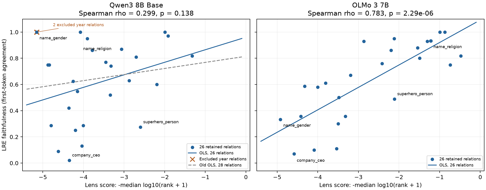

# Qwen3 8B Base: Figure 1 mit 26 Relationen

**Nachtrag zur Interpretation:** Die [Implementierungsprüfung](qwen3-jlens-implementation-review.md)
zeigt einen Positionseffekt in Qwens differentieller Lens: Die Mischung
sehr großer Zustände an Tokenposition 0 mit kleineren späteren Zuständen
erzeugt die wiederkehrenden `-Semit`-Ausgaben bei Länderrelationen.
Die folgenden historischen Zahlen bleiben unverändert; ihr Ausschluss
der beiden Jahresrelationen behebt diesen separaten Effekt nicht.

Stand: 20. September 2026. Modell: `Qwen/Qwen3-8B-Base`, Revision
`49e3418fbbbca6ecbdf9608b4d22e5a407081db4`; `main`-Protokoll.

**Beide Jahresrelationen sind ausgeschlossen:** `presidents_birth_year` und
`presidents_election_year`. **`name_gender` bleibt enthalten.** Die OLS-Gerade
wurde auf den übrigen 26 Punkten neu gefittet; alle Vorhersagen, Residuen und
Outlier-Rangfolgen unten verwenden diesen neuen Fit. Die gemessenen x-/y-Werte
bleiben unverändert. Die LREs selbst wurden nicht neu trainiert oder ausgewählt.

Qwen: **Spearman ρ = 0.298768, p = 0.138179**;
**Pearson r = 0.320774, p = 0.110100** (zweiseitig).
Der Zusammenhang ist stärker als mit 28 Relationen, erreicht hier aber nicht
das 5-%-Signifikanzniveau. Die deskriptiven Outlier sind keine formal getesteten Anomalien.

## Warum der Ausschluss die Outlier verändert

Ein Residuum ist `y − (a + b × x)`. Werden Punkte entfernt, ändern sich
Intercept und Steigung, also auch die Residuen der verbleibenden Punkte.
Nur die zwei Tabellenzeilen zu löschen hätte diesen Effekt nicht erfasst.

| Modell / Auswahl | n | Intercept a | Steigung b | Spearman ρ | p |
| --- | ---: | ---: | ---: | ---: | ---: |
| Qwen, bisher | 28 | 0.815096 | 0.046492 | 0.060390 | 0.760165 |
| Qwen, ohne Jahre | 26 | 0.960860 | 0.095745 | 0.298768 | 0.138179 |
| OLMo, bisher | 28 | 1.075649 | 0.158871 | 0.770916 | 1.58388e-06 |
| OLMo, ohne Jahre | 26 | 1.091883 | 0.171401 | 0.782758 | 2.29141e-06 |

Neue Qwen-Gerade:

```text
ŷ = 0.960860409076243 + 0.095744918107672 × x
Δ = y − ŷ
```



[PDF zum Export](qwen3-8b-base-figure1-26-relations.pdf). Die orangefarbenen Kreuze zeigen
die zwei ausgeschlossenen Qwen-Punkte nur zur Orientierung. Sie gehen nicht
in den neuen Fit ein; die gestrichelte Gerade ist der alte 28-Punkte-Fit.

Die Jahresrelationen haben bei Qwen y = 1 trotz sehr schwachem Lens-Score.
Wie der [Tokenisierungs-Audit](tokenization-years-small-relations.md) zeigt,
stimmen Modell und LRE dort jeweils auf dem ersten Token `1` überein; auch
ein konstanter Intercept erreicht diese Faithfulness. OLMo sagt dagegen
unterschiedliche dreistellige Präfixe voraus. Die Aufgaben unterscheiden sich
damit in der Aussagekraft des ersten Tokens.

## Alle 26 Qwen-Relationen, nach absolutem Residuum sortiert

**x:** `−median(log10(rank_diff + 1))` der differentiellen Lens (State-Index 19).
**y:** gemessene LRE-Faithfulness, also Top-1-Token-Übereinstimmung mit dem Modell;
höhere Werte sind besser, `0.02` bedeutet 2 % und keine Fehlerquote.
**ŷ:** Vorhersage der OLS-Geraden. **Δ:** `y − ŷ`, hier in Prozentpunkten (PP).
Positiv: höhere Faithfulness als vorhergesagt; negativ: niedrigere.
Die Regression gewichtet jede Relation gleich, unabhängig von den Testzeilenzahlen.

„Alter Rang“ sortiert dieselben 26 Relationen nach ihren absoluten Residuen
unter der ursprünglichen 28-Punkte-Geraden. Dadurch zeigt die Rangänderung
den Effekt des erneuten Fits zusätzlich zum Wegfall der zwei Relationen.

| Rang | Relation | n Lens | n LRE | x | y | ŷ neu | Δ neu (PP) | Δ alt (PP) | Alter Rang |
| ---: | --- | ---: | ---: | ---: | ---: | ---: | ---: | ---: | ---: |
| 1 | `name_gender` | 11 | 3 | -5.151600 | 1.000000 | 0.467621 | +53.237908 | +42.441270 | 4 |
| 2 | `company_ceo` | 20 | 100 | -4.347938 | 0.020000 | 0.544567 | -52.456741 | -59.295122 | 1 |
| 3 | `person_mother` | 20 | 100 | -4.036062 | 0.130000 | 0.574428 | -44.442798 | -49.745101 | 3 |
| 4 | `superhero_person` | 20 | 84 | -2.597462 | 0.273810 | 0.712167 | -43.835706 | -42.052503 | 5 |
| 5 | `name_religion` | 20 | 15 | -4.076097 | 1.000000 | 0.570595 | +42.940521 | +37.441032 | 6 |
| 6 | `person_father` | 20 | 100 | -4.620965 | 0.090000 | 0.518426 | -42.842649 | -51.025763 | 2 |
| 7 | `landmark_on_continent` | 20 | 100 | -3.904485 | 0.950000 | 0.587026 | +36.297422 | +31.643171 | 9 |
| 8 | `superhero_archnemesis` | 20 | 80 | -4.200516 | 0.250000 | 0.558682 | -30.868238 | -36.980521 | 7 |
| 9 | `pokemon_evolutions` | 20 | 28 | -4.003584 | 0.285714 | 0.577538 | -29.182333 | -34.324671 | 8 |
| 10 | `person_native_language` | 20 | 100 | -3.785382 | 0.860000 | 0.598429 | +26.157070 | +22.089435 | 13 |
| 11 | `country_language` | 16 | 8 | -4.876662 | 0.750000 | 0.493945 | +25.605524 | +16.163028 | 16 |
| 12 | `country_largest_city` | 16 | 8 | -4.839913 | 0.750000 | 0.497463 | +25.253671 | +15.992174 | 17 |
| 13 | `name_birthplace` | 20 | 15 | -1.992489 | 1.000000 | 0.770090 | +22.991025 | +27.753893 | 11 |
| 14 | `country_currency` | 20 | 14 | -4.797193 | 0.285714 | 0.501554 | -21.583923 | -30.635011 | 10 |
| 15 | `person_plays_instrument` | 20 | 100 | -3.062620 | 0.870000 | 0.667630 | +20.236985 | +19.729159 | 14 |
| 16 | `person_plays_pro_sport` | 20 | 100 | -1.915230 | 0.970000 | 0.777487 | +19.251315 | +24.394703 | 12 |
| 17 | `person_band_lead_singer` | 13 | 5 | -2.195900 | 0.600000 | 0.750614 | -15.061418 | -11.300406 | 21 |
| 18 | `person_occupation` | 20 | 100 | -3.449843 | 0.770000 | 0.630555 | +13.944454 | +11.529443 | 20 |
| 19 | `star_constellation` | 20 | 100 | -4.361620 | 0.420000 | 0.543257 | -12.325744 | -19.231512 | 15 |
| 20 | `company_hq` | 20 | 100 | -3.340255 | 0.520000 | 0.641048 | -12.104799 | -13.980056 | 18 |
| 21 | `landmark_in_country` | 20 | 100 | -2.705304 | 0.810000 | 0.701841 | +10.815873 | +12.067924 | 19 |
| 22 | `person_plays_position_in_sport` | 20 | 100 | -3.322126 | 0.740000 | 0.642784 | +9.721627 | +7.935659 | 22 |
| 23 | `country_capital_city` | 16 | 8 | -4.253334 | 0.625000 | 0.553625 | +7.137475 | +0.765044 | 26 |
| 24 | `product_by_company` | 20 | 100 | -2.873180 | 0.630000 | 0.685768 | -5.576802 | -5.151585 | 25 |
| 25 | `person_university` | 20 | 75 | -4.148308 | 0.546667 | 0.563681 | -1.701435 | -7.556580 | 23 |
| 26 | `city_in_country` | 19 | 11 | -1.322219 | 0.818182 | 0.834265 | -1.608281 | +6.455851 | 24 |

Die größten positiven Abweichungen: `name_gender` (+53.24 PP), `name_religion` (+42.94 PP), `landmark_on_continent` (+36.30 PP).

Die größten negativen Abweichungen: `company_ceo` (-52.46 PP), `person_mother` (-44.44 PP), `superhero_person` (-43.84 PP).

`person_father` rutscht innerhalb der negativen Ausreißer hinter `person_mother`
und `superhero_person`. `company_ceo` bleibt der größte negative Ausreißer.

## Welche Relationen unterscheiden Qwen und OLMo?

Verglichen werden dieselben 26 Relationsnamen, aber jeweils die Messwerte und
die separat neu gefittete Gerade des jeweiligen Modells. Die Tabelle zeigt die
acht größten absoluten Unterschiede `Δ_Qwen − Δ_OLMo`. Diese Differenz beschreibt
eine unterschiedliche Lage relativ zum jeweiligen Trend; sie ist kein kausaler
Nachweis und kein Test auf einen signifikanten Unterschied zwischen Modellen.

| Relation | x Qwen | x OLMo | y Qwen | y OLMo | Δ Qwen (PP) | Δ OLMo (PP) | Differenz (PP) |
| --- | ---: | ---: | ---: | ---: | ---: | ---: | ---: |
| `name_gender` | -5.151600 | -4.918994 | 1.000000 | 0.333333 | +53.237908 | +8.457318 | +44.780590 |
| `name_religion` | -4.076097 | -1.219666 | 1.000000 | 0.933333 | +42.940521 | +5.050299 | +37.890222 |
| `company_hq` | -3.340255 | -3.999305 | 0.520000 | 0.580000 | -12.104799 | +17.360375 | -29.465174 |
| `company_ceo` | -4.347938 | -4.585583 | 0.020000 | 0.070000 | -52.456741 | -23.590742 | -28.865999 |
| `country_capital_city` | -4.253334 | -0.738561 | 0.625000 | 0.750000 | +7.137475 | -21.529256 | +28.666731 |
| `person_university` | -4.148308 | -4.325163 | 0.546667 | 0.586667 | -1.701435 | +23.612290 | -25.313725 |
| `country_currency` | -4.797193 | -4.415347 | 0.285714 | 0.357143 | -21.583923 | +2.205675 | -23.789599 |
| `superhero_person` | -2.597462 | -2.112267 | 0.273810 | 0.488095 | -43.835706 | -24.174214 | -19.661492 |

Besonders aufschlussreich sind folgende Kandidaten für eine weitere Untersuchung:

- `name_gender`: sehr schlechter Lens-Score bei beiden Modellen, aber Qwen-Faithfulness
  1.0 gegenüber 1/3 bei OLMo. Die Relation hat nur drei LRE-Testzeilen und bleibt
  eine deutliche Quelle von Stichprobenunsicherheit in dieser 26-Relationen-Auswertung.
- `name_religion`: hohe Faithfulness bei beiden Modellen, aber ein deutlich
  schlechterer Lens-Score bei Qwen. Qwen liegt daher weit über seinem Trend.
- `company_ceo`, `company_hq` und `person_university`: Qwen liegt relativ zum
  eigenen Fit deutlich niedriger als OLMo. Sowohl x als auch y und die
  unterschiedlichen Messprotokolle müssen zur Erklärung betrachtet werden.

Der Ausschluss der Jahre verkleinert den beobachteten Spearman-Abstand zwischen
OLMo und Qwen von 0.710526 auf
0.483989; er beseitigt ihn nicht.
Eine zusätzliche Entfernung von `name_gender` ergäbe bei Qwen ρ = 0.448336
(25 Relationen). Das ist eine separate Sensitivitätsanalyse und wurde hier
nicht zur Auswahl der 26 Relationen verwendet.

## Daten, Grenzen und Reproduktion

- [26 Qwen-Datenpunkte, ungerundet](qwen3-8b-base-figure1.csv), einschließlich neuer und alter Residuen.
- [Qwen-/OLMo-Vergleich für alle 26 Relationen](qwen3-8b-base-figure1-olmo-comparison.csv).
- [Archivierter 28-Relationen-Bericht](qwen3-8b-base-figure1-28-relations.md) und
  [unveränderter 28-Punkte-CSV-Snapshot](qwen3-8b-base-figure1-28-relations.csv).
- [Konkrete CEO-Vorhersagen](qwen3-8b-base-company-ceo-predictions.md).

Der Qwen-Eingabesnapshot enthält die ungerundeten Originalmessungen und die
SHA-256-Prüfsummen der lokalen Rohdateien. Der OLMo-Vergleich verwendet
[`results/olmo/results/paper_figure_data.json`](../results/olmo/results/paper_figure_data.json)
aus dem aktuellen Ergebnissnapshot: OLMo-3-1025-7B, Lens-State-Index 17.
Dieser Snapshot ergibt ρ = 0.770916 über 28 Relationen; er ist nicht der
historische `olmo-old`-Snapshot mit dem im ursprünglichen Paper berichteten ρ ≈ 0.658.

Unterschiede in Tokenisierung, Vokabular und Modellmessungen bleiben bestehen.
Die `main`-Lens- und LRE-Splits werden unabhängig erzeugt. Die Testzeilenzahlen
sind nicht immer Anzahlen eindeutiger Subjekte. LRE-Layer und β wurden auf den
ausgewerteten Beispielen ausgewählt; die Faithfulness ist daher eine In-Sample-Schätzung.
Die Outlier-Analyse ist deskriptiv und verwendet keine nachträgliche Entfernung weiterer Punkte.

Regeneration auf CPU aus den versionierten Dateien:

```sh
cd code
uv run python ../paper/repro/qwen3_26_relations.py
```

Das Skript prüft die exakte Relationsauswahl, die Reproduktion des alten Fits,
einen unabhängigen OLS-Lösungsweg und die OLS-Residualbedingungen. Es schreibt
den Bericht, beide CSVs sowie die PNG-/PDF-Abbildung neu.
