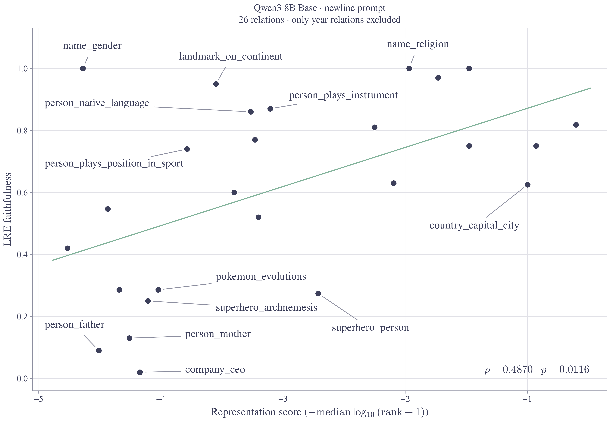

# Qwen3 8B Base: LRE faithfulness versus representation score



[Vector PDF](relation_agreement.pdf) · [All plotted values](relation_scores.csv) · [Exact statistics](statistics.json)

[Inspect the top 100 `name_gender` J-lens predictions per example](name_gender_top100.md) · [Top-five summary](name_gender_predictions.md).

[Compare the same examples with the earlier `Facts about {name}:` prompt](name_gender_facts_about_top100.md).

The Figure 1 comparison uses the latest newline-prompt measurements for
`Qwen/Qwen3-8B-Base`, main protocol, fixed lens state 19. Only
`presidents_birth_year` and `presidents_election_year` are excluded. All saved
examples and values for the other 26 relations are retained, including
`name_gender` and relations with fewer than four LRE tests. There are 491 lens
examples. No prompts, targets, splits, layers, or LRE values were changed for
this plot; no model inference was rerun.

- **Spearman ρ = 0.4869954654**, two-sided p = 0.0116311740.
- **Pearson r = 0.5284105848**, two-sided p = 0.0055204826.

Each point is one relation, equally weighted. The horizontal axis is the
differential representation score, `−median(log10(rank_diff + 1))`, where the
saved ranks are zero-based and higher scores mean better target-token ranks.
The vertical axis is retained LRE model-top-1 faithfulness, not gold-answer
accuracy. The green line is an ordinary least-squares fit to the 26 plotted
points, matching Figure 1's convention. All 13 relations with an absolute
vertical residual of at least 0.20 faithfulness units have direct name labels
and leader lines. This is a descriptive labeling rule, not a statistical
outlier test, and it does not remove or modify any points. The larger figure
uses 10-point names with white backgrounds; the CSV identifies every point.

The frozen CSV is an exact subset of
`code/results/all_model_newline/relation_scores.csv`, selecting
`model=qwen3_8b_base`, `protocol=main`, `version=newline`, and `kind=diff`, then
excluding only the two year relations. Its source hashes were checked and
every plotted score was recomputed from all saved per-subject ranks. The CSV
includes the source paths and SHA-256 hashes for provenance; those paths refer
to the measurement workspace. The CSV alone is sufficient to rebuild this
figure with the repository's plotting style.

From the repository root, using an environment with NumPy, SciPy, and Matplotlib:

```sh
python code/docs/qwen3-8b-base-no-years/plot.py
```
