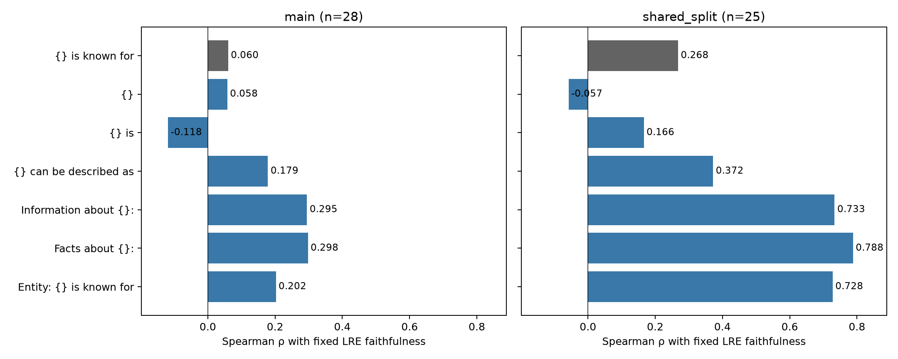

# Qwen3-8B-Base: neutral-prompt sensitivity

Experiment date: 21 September 2026.

**Changing the neutral prompt substantially changes Qwen's differential
Jacobian-lens correlation with LRE faithfulness.** `Facts about {}:` raises
Spearman correlation from **0.060 to 0.298** across all 28 main-protocol
relations, and from **0.268 to 0.788** across the 25 shared-split relations.
`Information about {}:` and `Entity: {} is known for` also improve both
protocols. Bare subject and `{} is` do not improve either protocol.

The evidence supports prompt sensitivity, particularly an effect of prefix
context. It does not establish that the best observed prompt will generalize
to new splits, models, or relation sets.

## Question and experimental control

The experiment tests whether the low Qwen correlation depends on the neutral
prompt `{} is known for`. An earlier [implementation review](qwen3-jlens-implementation-review.md)
identified unusually large first-position subject activations and showed that
prefixes changed the country-language readout. This comparison extends the
prompt check to the full relation sets.

Six alternatives and the original control were fixed before this run. Here,
“neutral” means relation-agnostic: no prompt names the tested relation, supplies
an answer, or includes relation-specific examples. The alternatives cover
minimal completions, generic descriptive wording, and informational prefixes.
They are not assumed to be semantically interchangeable.

All variants use `Qwen/Qwen3-8B-Base`, revision
`49e3418fbbbca6ecbdf9608b4d22e5a407081db4`, float32, eager attention, and hidden
state 19, the output of zero-based block 18. Within each protocol, the subject
and reference selections, relation-prompt target tokens, and saved LRE
faithfulness scores are held fixed. Neither layer nor beta is retuned. Only
the neutral prompt used by the differential lens changes.

For each relation, the lens score is:

```text
x = −median(log10(target_token_rank + 1))
y = retained LRE faithfulness
```

Ranks are zero-based, so higher x means better target-token ranks. The target
is the model's top-1 continuation under the relation prompt with eight
demonstrations. Faithfulness measures agreement with that model prediction;
it is not accuracy against the dataset's gold answer. Correlations give each
relation equal weight.

The main lens uses its original seed-17 split, at most 20 test subjects, and
eight references drawn from those test rows, excluding self-comparisons. Its
LRE uses the original independent split. The shared protocol uses its existing
identifying-first-token filter and disjoint reference/test rows, with at most
100 test subjects. Duplicate subjects in the input mean disjoint rows do not
always imply disjoint subjects. Shared eligibility excludes
`person_band_lead_singer`, `presidents_birth_year`, and
`presidents_election_year`. Differences between the two protocols therefore
combine cohort and sampling changes; the controlled comparisons are between
prompts within each protocol.

## Results for every tested prompt

| Neutral prompt | Main Spearman ρ, n=28 | Shared-split Spearman ρ, n=25 |
| --- | ---: | ---: |
| `{} is known for` | 0.0604 | 0.2680 |
| `{}` | 0.0579 | −0.0575 |
| `{} is` | −0.1180 | 0.1662 |
| `{} can be described as` | 0.1787 | 0.3721 |
| `Information about {}:` | 0.2948 | 0.7334 |
| `Facts about {}:` | **0.2976** | **0.7881** |
| `Entity: {} is known for` | 0.2023 | 0.7276 |

Pearson correlation also increases with `Facts about {}:`: **0.1590 → 0.4122**
in main and **0.3263 → 0.8124** in shared split. The
[full-precision correlation CSV](../results/qwen_prompt_sensitivity/correlations.csv)
contains Pearson and Spearman results, p-values, and intervals for every
prompt and cohort.



### Uncertainty in the improvement

Paired percentile bootstrap intervals resample relations, using the same
sampled relation indices for each alternative and its baseline: 10,000 draws,
seed 20260921. The following are changes in Spearman ρ relative to the freshly
rerun `{} is known for` control.

| Prefix alternative | Main Δρ [95% CI] | Shared Δρ [95% CI] |
| --- | --- | --- |
| `Information about {}:` | +0.2344 [−0.0089, +0.4948] | +0.4654 [+0.0821, +0.8639] |
| `Facts about {}:` | +0.2372 [+0.0020, +0.4765] | +0.5201 [+0.1503, +0.8927] |
| `Entity: {} is known for` | +0.1419 [−0.0850, +0.4187] | +0.4596 [+0.1006, +0.8367] |

The shared-split improvements are substantially larger than the main
improvements. The main estimate for `Facts about {}:` remains modest: its
correlation with faithfulness has an unadjusted two-sided p-value of 0.1240.
Its paired improvement interval only narrowly excludes zero. These are
different statistical questions; an improvement over a weak baseline does
not establish a strong absolute correlation.

All intervals and p-values are unadjusted for multiple comparisons. The
bootstrap describes relation-sampling uncertainty, not variability from new
subject splits or re-estimating LREs. Shared subjects and related semantic
domains also make independent-relation resampling an approximation.

### Previously identified small-relation sensitivity

Applying the earlier audit's rule of retaining relations with at least four
LRE test rows removes three main relations: `name_gender`,
`presidents_birth_year`, and `presidents_election_year`. Each has only three
LRE tests. This is a secondary, changed-cohort analysis.

| Neutral prompt | Main ρ, n=25 |
| --- | ---: |
| `{} is known for` | 0.4483 |
| `{}` | 0.2805 |
| `{} is` | 0.2259 |
| `{} can be described as` | 0.5888 |
| `Information about {}:` | 0.6762 |
| `Facts about {}:` | 0.6801 |
| `Entity: {} is known for` | 0.6404 |

Prompt effects persist after this exclusion. The main all-28 result must
still be reported alongside the more favorable restricted-cohort result.
The CSV also retains the same threshold analysis for shared split, where
24 relations remain.

## Interpretation

All three prefixed prompts improve the observed correlation in both
protocols. In particular, `Entity: {} is known for` retains the original
words and still improves the shared result to 0.7276. This suggests that
subject context or position contributes to the failure of the original setup.
It does not isolate a purely positional mechanism, because the prefix also
changes semantic context and tokenization.

Suffix-only changes leave the subject state causally unaffected when subject
tokenization is unchanged, but change the continuation through which the
Jacobian is computed. Their weaker results, and the failure of bare subject
to improve correlation, show that simply shortening the prompt is insufficient
in this experiment.

`Facts about {}:` is a useful candidate for a follow-up with the prompt frozen
before evaluating fresh splits. It performed best here, but selecting it using
these outcomes remains exploratory. The two protocols reuse the model and
dataset and are not independent replications. The experiment does not test
Qwen3.8-27B, and retained LRE scores still reflect their original in-sample
layer/beta selection and first-token targets.

## Validation and reproducible snapshot

All **371 prompt–relation measurements** completed: 7×28 main and 7×25 shared.
Every variant was checked against the retained subjects, target IDs, reference
counts, and split fingerprints. Each prompt evaluates 513 main lens rows and
1,544 shared lens rows.

The original Spearman correlations reproduced exactly. Individual baseline
ranks were not all bitwise identical: 41/513 main ranks changed by at most four
positions, and 75/1,544 shared ranks by at most two. Every GPU worker passed
logit reconstruction, batched-versus-scalar Jacobian-product, and
finite-difference checks. Twelve focused scorer tests passed, including
bare-subject and prefixed prompts. The bootstrap implementation was checked
against SciPy on tied values and repeated resamples.

This commit includes a compact snapshot:

- [Relation scores](../results/qwen_prompt_sensitivity/relation_scores.csv):
  all 371 points, their fixed faithfulness, and lens/LRE sample counts.
- [Correlations and intervals](../results/qwen_prompt_sensitivity/correlations.csv):
  all prompts under both full and minimum-four-test cohorts.
- [Summary and provenance](../results/qwen_prompt_sensitivity/summary.json):
  checkpoint, worker environments, measurement-code hashes, numerical checks,
  and bootstrap configuration.
- [PDF figure](../results/qwen_prompt_sensitivity/correlations.pdf).

The snapshot is sufficient to reproduce every reported correlation and paired
interval without model weights. From `code/`, run:

```sh
.venv/bin/python scripts/reproduce_qwen_prompt_sensitivity.py
```

The verifier recomputes all 28 prompt/protocol/cohort summaries from the
relation-score CSV and compares them with the retained full-precision CSV.
Subject-level raw outputs and the GPU experiment runner remain in the original
local experiment workspace; they are not included in this compact writeup
commit. The provenance hashes identify the code used for those measurements.
