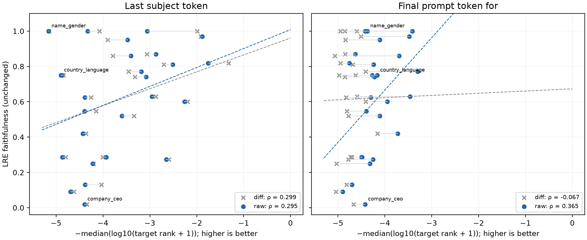

# Qwen3 8B Base: J-lens without subtraction

Measured 20 September 2026, on the same 26 non-year relations as the [position experiment](last-position-lre-correlation.md). `name_gender` is retained.

The requested raw J-lens is the repository's matched baseline: **`v_raw(e) = mean_{i != e} J_i h_e`**. The differential control is **`v_diff(e) = mean_{i != e} J_i (h_e − h_i)`**. Each Jacobian is evaluated in its reference's neutral prompt; this retains reference averaging and self-exclusion. No reference output or affine intercept is added.

Both readouts are computed at the original last-subject-token position and at the final token `for`. The prompt remains `{subject} is known for`, with no prefix. The checkpoint, state 19, targets, references, and LRE faithfulness values are fixed. The output remains the raw final-block state at the last prompt position, decoded with the native final normalization and output head.

**At the original subject position, removing subtraction gives almost the same correlation:** Spearman ρ = 0.294661 (p = 0.143944), versus 0.298768 with subtraction. The repeated `-Semit` predictions persist, including 10/16 country-language subjects. This is not a remedy for that artifact.

At the final `for` position, the raw variant has a more positive correlation than the differential variant: ρ = 0.364819 (p = 0.066881), versus −0.067077. Its Pearson r is 0.416935 (p = 0.034092). However, none of its 491 targets is in the top 10, so the correlation concerns relative differences among very poor target rankings. These are exploratory results over the retained relations.

## Correlation with LRE faithfulness

The relation-level score is `x = −median(log10(rank + 1))`; y is the retained LRE top-1 faithfulness. Higher is better. Ranks are zero-based against the original model answer token, not full gold-answer accuracy. P-values test each correlation against zero, not the difference between variants.

| Position | Readout | Spearman ρ | p | Pearson r | p | Top 1 | Top 10 | `-Semit` top 1 |
| --- | --- | ---: | ---: | ---: | ---: | ---: | ---: | ---: |
| Last subject token | diff | 0.298768 | 0.138179 | 0.320772 | 0.110103 | 15/491 | 48/491 | 20/491 |
| Last subject token | raw | 0.294661 | 0.143944 | 0.346721 | 0.0826909 | 15/491 | 47/491 | 20/491 |
| Final prompt token `for` | diff | -0.067077 | 0.744746 | 0.008733 | 0.966228 | 0/491 | 0/491 | 0/491 |
| Final prompt token `for` | raw | 0.364819 | 0.0668811 | 0.416935 | 0.0340918 | 0/491 | 0/491 | 0/491 |

Top-k counts pool 491 scored rows, including the original duplicate rows; the correlation instead gives each of the 26 relations equal weight. No hyperparameters were selected using these new results.



[PDF](qwen3-8b-base-raw-jlens.pdf) · [Relation CSV](qwen3-8b-base-raw-jlens.csv) · [Full per-subject numerical evidence](qwen3-8b-base-raw-jlens.json).

## What removing subtraction changes

For a fixed reference, `J_i h_e = J_i(h_e − h_i) + J_i h_i`. Thus removing subtraction adds a reference-dependent vector before normalization and decoding. It does not add the affine Taylor term `f_i(h_i)`. Nor does it remove the large input coordinates or ensure that reference and subject states belong to the same positional regime. The raw result must be measured; it does not automatically cure the positional artifact.

This refines the [earlier diagnosis](qwen3-jlens-implementation-review.md): **subtraction is not necessary for the repeated-token artifact.** The raw lens still applies reference Jacobians to the large position-0 subject state. For Germany, the two later-position references still dominate, and dropping the subtraction barely changes their contribution norms:

| Reference for Germany | Differential contribution norm | Raw contribution norm | Norm of removed term J_i h_i |
| --- | ---: | ---: | ---: |
| Australia | 9.060 | 37.661 | 37.365 |
| Peru | 7170.070 | 7173.538 | 72.497 |
| United States | 4933.006 | 4938.585 | 49.286 |

These are vector norms; the norms themselves are not additive. The direct vector identity is checked numerically below. The persistent artifact implicates the combination of positional state differences and reference Jacobians, rather than the subtraction operation alone.

## All relation points

Raw-readout OLS residuals are refitted independently for each position over all 26 relations: residual = y − fitted y.

### Last subject token

`ŷ = 1.008169716816 + 0.107146887461 × x_raw`

| Relation | n | Differential x | Raw x | LRE y | Fitted y | Raw residual |
| --- | ---: | ---: | ---: | ---: | ---: | ---: |
| name_gender | 11 | -5.151600 | -5.161590 | 1.000000 | 0.455121 | +0.544879 |
| company_ceo | 20 | -4.347938 | -4.394741 | 0.020000 | 0.537287 | -0.517287 |
| name_religion | 20 | -4.076097 | -4.326109 | 1.000000 | 0.544641 | +0.455359 |
| superhero_person | 20 | -2.597462 | -2.648480 | 0.273810 | 0.724393 | -0.450584 |
| person_father | 20 | -4.620961 | -4.695432 | 0.090000 | 0.505069 | -0.415069 |
| person_mother | 20 | -4.036062 | -4.378661 | 0.130000 | 0.539010 | -0.409010 |
| name_birthplace | 20 | -1.992489 | -3.056771 | 1.000000 | 0.680646 | +0.319354 |
| landmark_on_continent | 20 | -3.904485 | -3.473629 | 0.950000 | 0.635981 | +0.314019 |
| superhero_archnemesis | 20 | -4.200516 | -4.218805 | 0.250000 | 0.556138 | -0.306138 |
| pokemon_evolutions | 20 | -4.003584 | -3.932053 | 0.285714 | 0.586862 | -0.301148 |
| country_language | 16 | -4.876662 | -4.894727 | 0.750000 | 0.483715 | +0.266285 |
| country_largest_city | 16 | -4.839917 | -4.876385 | 0.750000 | 0.485680 | +0.264320 |
| person_native_language | 20 | -3.785382 | -3.404345 | 0.860000 | 0.643405 | +0.216595 |
| country_currency | 20 | -4.797189 | -4.867978 | 0.285714 | 0.486581 | -0.200867 |
| person_plays_instrument | 20 | -3.062620 | -2.872523 | 0.870000 | 0.700388 | +0.169612 |
| person_band_lead_singer | 13 | -2.195900 | -2.257679 | 0.600000 | 0.766266 | -0.166266 |
| person_plays_pro_sport | 20 | -1.915230 | -1.880287 | 0.970000 | 0.806703 | +0.163297 |
| star_constellation | 20 | -4.361620 | -4.429234 | 0.420000 | 0.533591 | -0.113591 |
| company_hq | 20 | -3.340110 | -3.597315 | 0.520000 | 0.622729 | -0.102729 |
| person_occupation | 20 | -3.449843 | -3.181570 | 0.770000 | 0.667274 | +0.102726 |
| country_capital_city | 16 | -4.253334 | -4.388193 | 0.625000 | 0.537988 | +0.087012 |
| landmark_in_country | 20 | -2.705304 | -2.510677 | 0.810000 | 0.739158 | +0.070842 |
| person_plays_position_in_sport | 20 | -3.322126 | -3.082945 | 0.740000 | 0.677842 | +0.062158 |
| product_by_company | 20 | -2.873180 | -2.957618 | 0.630000 | 0.691270 | -0.061270 |
| person_university | 20 | -4.148330 | -4.394491 | 0.546667 | 0.537314 | +0.009353 |
| city_in_country | 19 | -1.322219 | -1.755875 | 0.818182 | 0.820033 | -0.001851 |

### Final prompt token `for`

`ŷ = 1.850821465195 + 0.296181797513 × x_raw`

| Relation | n | Differential x | Raw x | LRE y | Fitted y | Raw residual |
| --- | ---: | ---: | ---: | ---: | ---: | ---: |
| company_ceo | 20 | -4.667301 | -4.420638 | 0.020000 | 0.541509 | -0.521509 |
| name_religion | 20 | -4.597022 | -4.418358 | 1.000000 | 0.542184 | +0.457816 |
| name_gender | 11 | -4.944443 | -4.373647 | 1.000000 | 0.555427 | +0.444573 |
| person_plays_instrument | 20 | -4.845650 | -4.626445 | 0.870000 | 0.480553 | +0.389447 |
| city_in_country | 19 | -4.946609 | -4.757798 | 0.818182 | 0.441648 | +0.376534 |
| person_mother | 20 | -4.817199 | -4.699913 | 0.130000 | 0.458793 | -0.328793 |
| star_constellation | 20 | -4.157865 | -3.723421 | 0.420000 | 0.748012 | -0.328012 |
| superhero_archnemesis | 20 | -5.029739 | -4.319862 | 0.250000 | 0.571357 | -0.321357 |
| superhero_person | 20 | -4.781646 | -4.251777 | 0.273810 | 0.591523 | -0.317713 |
| landmark_on_continent | 20 | -4.836742 | -4.109991 | 0.950000 | 0.633517 | +0.316483 |
| person_father | 20 | -5.042315 | -4.899934 | 0.090000 | 0.399550 | -0.309550 |
| pokemon_evolutions | 20 | -4.701151 | -4.482595 | 0.285714 | 0.523159 | -0.237444 |
| country_currency | 20 | -4.734048 | -4.497411 | 0.285714 | 0.518770 | -0.233056 |
| landmark_in_country | 20 | -4.685907 | -4.239519 | 0.810000 | 0.595153 | +0.214847 |
| product_by_company | 20 | -4.595726 | -3.461728 | 0.630000 | 0.825521 | -0.195521 |
| country_largest_city | 16 | -4.621028 | -4.270717 | 0.750000 | 0.585913 | +0.164087 |
| name_birthplace | 20 | -4.851275 | -3.411271 | 1.000000 | 0.840465 | +0.159535 |
| person_plays_pro_sport | 20 | -4.510298 | -3.477683 | 0.970000 | 0.820795 | +0.149205 |
| person_plays_position_in_sport | 20 | -4.848891 | -4.224297 | 0.740000 | 0.599662 | +0.140338 |
| country_language | 16 | -4.977771 | -4.162553 | 0.750000 | 0.617949 | +0.132051 |
| company_hq | 20 | -4.770408 | -4.106886 | 0.520000 | 0.634437 | -0.114437 |
| person_occupation | 20 | -4.410072 | -3.296898 | 0.770000 | 0.874340 | -0.104340 |
| person_native_language | 20 | -5.064447 | -3.695659 | 0.860000 | 0.756234 | +0.103766 |
| person_band_lead_singer | 13 | -4.408308 | -3.948706 | 0.600000 | 0.681287 | -0.081287 |
| country_capital_city | 16 | -4.829306 | -4.298522 | 0.625000 | 0.577678 | +0.047322 |
| person_university | 20 | -4.807436 | -4.393141 | 0.546667 | 0.549653 | -0.002986 |

## Country-language raw predictions

The target is the model's first answer token under the unchanged relation-specific ICL prompt.

| Subject | Target | Subject-position raw top 1 | Target rank | Final-position raw top 1 | Target rank |
| --- | --- | --- | ---: | --- | ---: |
| Australia | English | -Semit | 79624 | Mach | 1015 |
| Argentina | Spanish | -Semit | 148626 | Mach | 14277 |
| Egypt | Arabic | -Semit | 77339 | sights | 99288 |
| Peru | Spanish | Peru | 5587 | adventure | 12650 |
| Japan | Japanese | -Semit | 138035 | Mach | 17796 |
| United States | English | 美方 | 96822 | their | 734 |
| China | Mandarin | -Semit | 81434 | her | 3878 |
| Brazil | Portuguese | -Semit | 97651 | what | 11515 |
| Venezuela | Spanish | Venezuela | 15850 | relaxed | 8941 |
| India | Hindi | -Semit | 40810 | her | 14805 |
| Chile | Spanish | Chile | 17005 | growing | 16091 |
| Saudi Arabia | Arabic | Saudi | 88 | Mach | 16886 |
| Germany | German | -Semit | 138093 | Mach | 20909 |
| Spain | Spanish | -Semit | 148512 | Mach | 6553 |
| Russia | Russian | -Semit | 76984 | their | 36611 |
| South Korea | Korean | Koreans | 4 | Mach | 35017 |

## Country-capital raw predictions

The target is the model's first answer token under the unchanged relation-specific ICL prompt.

The [detailed country-capital report](qwen3-8b-base-country-capital-predictions.md) compares raw and differential top-five predictions at both positions for all 16 countries. It includes target ranks, token IDs, state norms, and downloadable per-reference contributions.

| Subject | Target | Subject-position raw top 1 | Target rank | Final-position raw top 1 | Target rank |
| --- | --- | --- | ---: | --- | ---: |
| Australia | Canberra | -Semit | 26064 | Mach | 77996 |
| Argentina | Buenos | -Semit | 56842 | Mach | 33841 |
| Egypt | Cairo | -Semit | 15051 | sights | 96622 |
| Peru | Lima | Peru | 2 | adventure | 13638 |
| Japan | Tokyo | -Semit | 98534 | Mach | 20715 |
| United States | Washington | 美方 | 54 | their | 19086 |
| China | Beijing | -Semit | 79295 | her | 32703 |
| Brazil | Bras | -Semit | 147247 | what | 52624 |
| Venezuela | Car | Venezuela | 22925 | relaxed | 2404 |
| India | New | -Semit | 135676 | her | 15597 |
| Chile | Santiago | Chile | 4 | growing | 3337 |
| Saudi Arabia | Riyadh | Saudi | 2 | Mach | 17597 |
| Germany | Berlin | -Semit | 124913 | Mach | 11706 |
| Spain | Madrid | -Semit | 93412 | Mach | 9376 |
| Russia | Moscow | -Semit | 10160 | their | 24372 |
| South Korea | Seoul | Koreans | 2 | Mach | 31051 |


## Validation and reproduction

- Differential controls: 982/982 ranks match the preceding position experiment exactly; maximum rank difference 0, maximum relation-score difference 0.
- The linear identity `J_i h_e − J_i h_i = J_i(h_e − h_i)` is checked for every reference and scored row at both positions. Maximum relative discrepancy, normalized by the sum of term norms: 4.25847e-06.
- 10 raw-product derivative checks cover both positions. Worst best-step central-finite-difference relative error: 0.00154979; batched/scalar JVP checks also pass.
- Every reference passes exact no-op intervention checks. Cached raw final states reproduce native logits. All 491 frozen target IDs are regenerated and match exactly; reference counts and duplicate/self-exclusion behavior are preserved.
- Pinned Qwen revision `49e3418fbbbca6ecbdf9608b4d22e5a407081db4`; float32, eager attention, A100 80 GB. Source and input hashes, per-reference contribution norms, and all ranks/top-five predictions are recorded in the JSON.

[GPU runner](../../paper/repro/qwen_raw_jlens.py), [CPU report generator](../../paper/repro/report_qwen_raw_jlens.py), [frozen inputs](last-position-lre-correlation-inputs.json).

```sh
cd code
CUDA_VISIBLE_DEVICES=0 uv run --extra gpu python ../paper/repro/qwen_raw_jlens.py
uv run python ../paper/repro/report_qwen_raw_jlens.py
```

For parallel GPU workers add `--shards 4 --shard 0` through `--shard 3`, assigning each worker a separate GPU. Historical measurements are retained.
