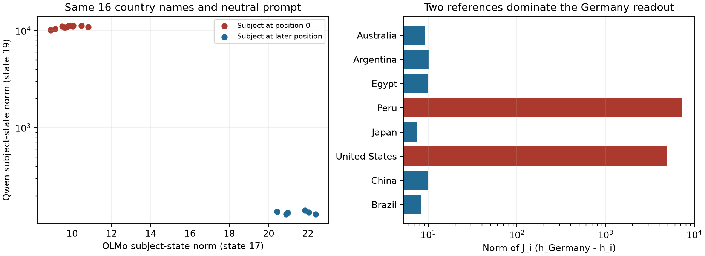

# Qwen3 differential Jacobian lens: implementation and measurement review

Review date: 20 September 2026. Main checkpoint: `Qwen/Qwen3-8B-Base` at
`49e3418fbbbca6ecbdf9608b4d22e5a407081db4`, float32, eager attention, state 19.

The [consolidated diagnosis](qwen3-8b-base-bug-diagnosis.md) includes all follow-up
experiments, the new Germany token-score decomposition and coordinate controls,
and [ordinary Qwen predictions](qwen3-8b-base-neutral-prompt-predictions.md) for
all 16 neutral country prompts. It distinguishes the tested implementation
properties from the open question of prompt suitability.

**The repeated `-Semit`, `(Initialized`, and related outputs are a real artifact
of the current measurement setup. They are not caused by an incorrect Jacobian
product, an off-by-one subject index, or decoding the wrong vocabulary IDs.**
The differential lens mixes Qwen subject states from the first token position
with subject states from later positions. The first-position states contain huge
activations that dominate cross-position differences and their Jacobian products.

A separate, genuine implementation bug was found and fixed in the generic
`final_logits` helper: it inferred normalization arithmetic from the existence
of a bias, which mishandles Gemma2 RMSNorm and bias-free LayerNorm. The Qwen
sweep already uses the actual model norm, so this bug does not explain the
Qwen outputs under investigation.

## 1. Main finding: position-dependent contamination of the lens

The implementation follows the stated differential-lens formula:

```text
v_e = mean over non-self references i of J_i (h_e - h_i)
logits_e = unembed(final_norm(v_e))
```

For the original prompt `{} is known for`, Qwen tokenizes `Germany`, `Japan`,
and eight other countries as one initial token. Their subject-state norms are
10,106–11,239. Names such as `Peru` and `United States` have multiple tokens;
at their final subject token, norms are only 128–141. The positions are located
correctly; the representations at those positions are numerically very different.

The reference set is Australia, Argentina, Egypt, Peru, Japan, United States,
China, and Brazil. For the Germany test state:

| Reference | Subject position | Norm of its contribution J_i(h_Germany − h_i) |
| --- | ---: | ---: |
| Australia | 0 | 9.060 |
| Argentina | 0 | 10.088 |
| Egypt | 0 | 9.934 |
| Peru | 1 | 7170.070 |
| Japan | 0 | 7.383 |
| United States | 1 | 4933.006 |
| China | 0 | 10.034 |
| Brazil | 0 | 8.310 |

The two later-position references dominate the sum. The ten first-position
countries consequently have nearly identical differential-vector directions: mean cosine **0.999885**,
minimum **0.999801**.
The same unusual tokens are therefore ranked first for different countries.

Two hidden coordinates, 2276 and 233 (zero-based), account for approximately
96.28% and 3.52% of the squared difference between the mean first-position and
mean later-position subject states. This is a first-token activation outlier;
this review does not identify which attention head or MLP originally creates it.



[PDF figure](qwen3-jlens-implementation-review.pdf). Absolute activation norms
are model-specific; the relevant observation is the extreme within-Qwen contrast.

## 2. Independent checks of the implementation

The review compared the live sweep to a separate direct execution of Qwen’s
remaining transformer blocks. The independent suffix replaces the subject state
by tensor concatenation, uses explicit causal masks and rotary positions, and
does not use the production intervention or output-capture hooks.

| Check | Result |
| --- | --- |
| Subject position against tokenizer offset spans | No mismatches in all 2,057 retained Qwen lens rows across main/shared protocols |
| Intervention state 19 vs. block-output cache | Exact equality |
| Reinsertion of the unmodified reference state | Exact equality with the original forward result |
| Direct suffix vs. full-model raw final state | Exact equality for all eight country references |
| Production reverse-over-reverse JVP vs. independent forward-mode AD, 8 × 16 directions | Maximum relative error 1.28e-06 |
| Central finite differences in actual country directions, 15 reference/subject pairs | Best of ε ∈ {0.01, 0.003, 0.001}: relative error ≤ 0.0078 for every pair |
| Reconstructed norm/head logits vs. normal Qwen logits | Relative error < 1e-5 for every checked prompt |
| Differential top-5 from RMS-normalized vs. unnormalized weighted unembedding | Identical token IDs |
| Original country-language top-5 lists | All 16 reproduced exactly |
| Original target ranks | 15 exact; Japan differs by one deep-tail position (137902 → 137901) on A100 vs. original A6000 |
| Relation aggregate and Top-1/Top-10 agreement | Reproduced exactly |

The one-rank difference has no effect on the relation’s median or reported
correlation input. Numerical precision does not explain the repeated top tokens.

Qwen’s final RMS normalization divides the weighted vector by a positive scalar.
With its unbiased output head, this changes logit scale but not token ordering.
The artifact remains when ranking `unembed(diag(norm_weight) × v)` directly.
The historical double-final-normalization bug is not present in this Qwen path.

Correct derivatives do not guarantee a useful large-step approximation. A direct
counterfactual check replaces the reference subject state by Germany’s state:

| Reference → Germany | Direction / reference norm | JVP norm | Actual full-step output-change norm | Relative linearization error |
| --- | ---: | ---: | ---: | ---: |
| Peru | 80.770 | 7170.070 | 389.113 | 18.258 |
| United States | 85.868 | 4933.006 | 150.357 | 32.846 |
| Australia | 0.042 | 9.060 | 8.674 | 0.046 |

The cross-position directions are about 81–86 times the reference-state norm.
The local Jacobians are accurate derivatives, but are poor approximations to
such large displacements. This is an extrapolation problem in the lens setup.

## 3. Controlled diagnostic variants

All variants below use the same 16 countries and the same frozen language target
IDs. Prefix variants retain the original eight reference identities and the same
self-exclusion rule; the language-target prompts and LRE measurements are unchanged.
The prefix is applied only to the neutral lens prompt. Reference-group variants
change the reference subset. The coordinate ablation changes only the input directions.

| Lens variant | `-Semit` Top-1 | Median zero-based target rank | Median log10(rank + 1) | Top-1 hits | Top-10 hits |
| --- | ---: | ---: | ---: | ---: | ---: |
| Original | 10/16 | 75290.5 | 4.876662 | 0/16 | 1/16 |
| Only first-position references | 0/16 | 2048.5 | 3.299213 | 0/16 | 1/16 |
| Only later-position references | 10/16 | 76336.0 | 4.882700 | 0/16 | 1/16 |
| Drop coordinates 2276 and 233 | 0/16 | 43614.0 | 4.638254 | 0/16 | 1/16 |
| `Entity: {country} is known for` | 0/16 | 49.5 | 1.701560 | 1/16 | 3/16 |
| Newline + `{country} is known for` | 0/16 | 29.0 | 1.476154 | 2/16 | 6/16 |

The prefix experiments reduce all subject-state norms to about 107–138 and
remove the repeated-token collapse. The newline control adds no words, which
strengthens the positional explanation. Removing two coordinates also removes
`-Semit`, but leaves poor target ranks: eliminating the suspicious output is not
by itself evidence that a corrected lens recovers the desired information.

**These are post-hoc diagnostic ablations, not replacement benchmark results.**
The two prefixes, reference subsets, and coordinate deletion are all reported;
no best variant was selected to update the Figure-1 correlation. A common prefix
changes the measured function and requires a consistently specified rerun across
relations and models before supporting new scientific claims.

### All 16 country results

Ranks are zero-based. Prefix Top-1 tokens are single decoded vocabulary tokens.

| Country | Original subject position | Original norm | Original rank | `Entity:` Top-1 / target rank | Newline Top-1 / target rank |
| --- | ---: | ---: | ---: | --- | --- |
| Australia | 0 | 10631.79 | 77082 | `澳洲` / 1105 | `澳洲` / 577 |
| Argentina | 0 | 10878.41 | 148524 | `阿根廷` / 112 | `阿根廷` / 148 |
| Egypt | 0 | 11176.02 | 76767 | `埃及` / 45 | `埃及` / 31 |
| Peru | 1 | 136.60 | 1961 | `Peru` / 155 | `Peru` / 382 |
| Japan | 0 | 11239.15 | 137901 | `Japanese` / 0 | `Japanese` / 0 |
| United States | 1 | 128.66 | 35520 | `NAFTA` / 7063 | `NAFTA` / 3724 |
| China | 0 | 10106.26 | 80402 | `制造` / 114 | `Mandarin` / 0 |
| Brazil | 0 | 11013.24 | 95053 | `巴西` / 25 | `巴西` / 27 |
| Venezuela | 2 | 140.97 | 8303 | `Maduro` / 3418 | `Venezuelan` / 5498 |
| India | 0 | 10390.16 | 38539 | `印度` / 12 | `Bollywood` / 12 |
| Chile | 1 | 132.84 | 11129 | `Chile` / 838 | `Chile` / 2162 |
| Saudi Arabia | 1 | 134.54 | 100 | `沙特` / 54 | `Saudi` / 52 |
| Germany | 0 | 11070.80 | 136572 | `Germany` / 14 | `Germany` / 5 |
| Spain | 0 | 11184.16 | 148355 | `西班牙` / 2 | `Spain` / 9 |
| Russia | 0 | 10834.38 | 73814 | `Putin` / 12 | `Putin` / 6 |
| South Korea | 1 | 128.42 | 5 | `是韩国` / 3 | `是韩国` / 1 |

## 4. Scope and implications for the Qwen–OLMo comparison

The saved Qwen outputs contain `-Semit` at Top-1 in:

- **20/513 main-protocol rows:** ten each in `country_capital_city` and `country_language`.
- **18/1544 shared-split rows:** six each in `country_capital_city`, `country_language`, and `country_largest_city`.
- **Every one of these 38 rows has its subject at token position 0.**
- None of the 16 ordinary full-model neutral-prompt Top-5 lists in the country test contains `-Semit`.

This is a count of the specific observed failure signature, not proof that every
other relation is free from positional contamination. The independent derivative
and intervention experiments above cover `country_language`; they do not
constitute a fresh GPU sweep of all relations or every supported architecture.

An OLMo control used the same 16 names and the same original neutral prompt,
with `allenai/Olmo-3-1025-7B` revision
`a81bae42db3975be1671e27b9c9a56da1a9f980f` at its designated state 17.
OLMo uses the same subject token positions here, but its first-position norms
are about 8.90–10.81 and later-position norms about 20.44–22.39. It does not
show Qwen’s roughly 80-fold first-position norm inflation. That is a concrete
model-by-measurement interaction that can affect cross-model comparisons.

The original Qwen Figure-1 numbers remain reproducible measurements of the
old procedure. They should **not** be treated as clean estimates of semantic
salience for affected relations. Excluding the two year relations does not
remove this separate artifact. The review does not establish how much of the
overall correlation gap remains under a revised, fixed protocol.

## 5. Confirmed software bug: architecture-specific final normalization

The generic [`final_logits`](../jlens/model.py) helper manually reconstructed
RMSNorm or LayerNorm by checking whether `norm.bias` existed. Two counterexamples
failed against the actual model/module:

- **Gemma2 RMSNorm** multiplies by `1 + weight`, whereas the helper multiplied
  by `weight`. Nonuniform weights can change token ordering, not just scale.
- **Bias-free LayerNorm** still subtracts the mean; the helper treated it as RMSNorm.

The fix calls `norm(hidden)` directly, retaining the existing unembedding,
optional output bias, and logit softcap. Two new regression tests fail before
and pass after this change. Existing OLMo, GPT-J, Gemma4, baseline, and readout
checks pass as well. The fix is in the generic helper; the Qwen/five-model sweep
already calls the native norm and head, so its retained results do not change
because of this fix.

## 6. Other implementation and evaluation checks

| Area | Assessment |
| --- | --- |
| Subject positions / block indexing | Checked against tokenizer offsets and raw block outputs; correct in audited Qwen runs |
| Forward and reverse derivatives | Independent forward AD, explicit suffix, finite differences and existing analytic tests agree |
| Prefix caching | Not enabled in these original Qwen3-8B runs; existing full/cached equivalence tests pass |
| Reference averaging | Correct sum/count and self-exclusion; main reference subjects are intentionally inside the lens test set |
| Vocabulary decoding and zero-based ranks | Correct for checked finite, non-tied outputs; Top-5 token IDs agree independently |
| Affine vs. differential output | Separate; `lens.top_lre` is a neutral affine baseline, not the relation-specific LRE |
| Model targets and gold answers | Faithfulness compares model Top-1 tokens, not complete gold facts; language target IDs remain fixed in this review |
| Splits and sample counts | Main lens/LRE splits differ; language has 16 lens vs. 8 LRE cases; small-n and duplicate-subject issues remain |
| Hyperparameter selection | LRE layer/β selected in-sample; no new tuning performed here |
| Existing defensive checks | No zero-reference row in the retained Qwen runs; fail-fast finite-value/zero-count checks are still advisable before ranking |

The rank implementation counts logits strictly greater than the target logit.
For an exactly tied zero vector this would give rank 0 to every target, and
NaNs would also invalidate the comparisons. Those cases were not observed in
the audited retained rows or reconstructed vectors; this is a remaining
hardening issue, not an explanation of the repeated nonzero Qwen outputs.

## 7. Recommended next step

Use a fixed neutral prefix that places subjects after an initial context token,
or explicitly control the reference positions, and record subject positions,
state norms, and per-reference contribution norms. Validate that protocol on
more than this one relation, then rerun the same 26-relation comparison for
Qwen and OLMo with the choice frozen. Do not choose the prefix by maximizing
the resulting correlation. No automatic prefix change or replacement of old
scientific results is included in this review.

## Follow-up: final prompt position

The [raw J-lens follow-up](qwen3-8b-base-raw-jlens.md) also removes subtraction
entirely, testing `mean_i J_i h_subject`. At the original subject position,
ρ = 0.294661 and the repeated `-Semit` predictions persist. For Germany, the
Peru-reference contribution norm is 7173.538 without subtraction versus 7170.070
with subtraction. Thus subtraction is not necessary for the artifact: applying
the reference Jacobians to the large position-0 subject state still produces it
in this experiment.

The [26-relation position ablation](last-position-lre-correlation.md) now tests
caching and intervening at `for`, keeping the original prompt and LRE scores.
Qwen's norm outliers and repeated `-Semit` predictions disappear, but its
correlation changes from ρ = 0.298768 to −0.067077 and none of the 491 targets
is in the top 10. OLMo changes from ρ = 0.782758 to 0.645912, also with much
worse absolute target ranks. This tests a different representation from the
newline-prefix controls above; removing the observed artifact is insufficient
to recover a useful Qwen lens.

## Evidence and reproduction

- [Full numerical evidence and test summary](qwen3-jlens-implementation-review.json).
- [Per-country CSV](qwen3-jlens-implementation-review.csv).
- [Standalone Qwen review runner](../../paper/repro/qwen_jlens_review.py).
- [Normalization regression tests](../tests/test_readout_norm.py).

The standalone runner uses the versioned country-language input and target
snapshot, a pinned cached Qwen checkpoint, and the published intervention helper.
Its cache and batched-JVP functions are retained copies of the audited sweep
functions. Its independent branch uses explicit suffix execution and forward AD.
Source hashes for both the original live audit and standalone reproduction are
in the JSON evidence. GPU vectors remain in the generated output directory.

```sh
cd code
CUDA_VISIBLE_DEVICES=0 uv run --extra gpu python ../paper/repro/qwen_jlens_review.py
JLENS_ROOT="$PWD/results/olmo" uv run --extra gpu pytest tests/test_readout_norm.py tests/test_model.py tests/test_baseline_measurements.py tests/test_matched_baseline.py -q
```

Validation performed: **90 tests passed** on the live sweep/derivative/split
code; **22 tests passed** for the fixed readout and affected baseline paths.
The latter use the explicit OLMo result root because retained snapshots are
under `results/olmo/results`, not directly under `results`. The two new
normalization regressions failed before the fix and passed after it.
