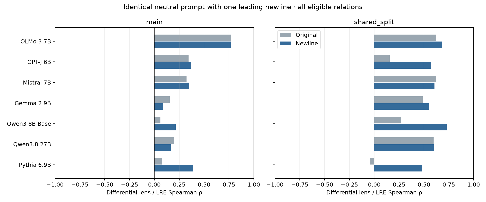

# All-model newline-prefix rerun

All models receive the identical neutral text template `\n{} is known for`, retaining their native tokenizer and special-token conventions. Model checkpoint, fixed lens layer, reference/test splits, and relation-prompt targets match the retained runs. Only the neutral lens prompt changes; LRE faithfulness and its selected layer/beta are retained. All measurements use float32/eager attention. No prompt, layer, or beta is selected to maximize the reported primary correlations.

The score is −median(log10(rank+1)), correlated across relations with LRE model-top-1 faithfulness. This is not complete-answer accuracy. Tables show coefficient (two-sided p-value).

**Spearman ρ, newline prompt, all eligible relations**

| Model | Main differential | Main affine β=1 | Shared differential | Shared affine β=1 |
| --- | ---: | ---: | ---: | ---: |
| OLMo 3 7B | 0.7662 (2.002e-06) | 0.3651 (0.05612) | 0.6827 (0.0001699) | 0.5623 (0.00344) |
| GPT-J 6B | 0.3689 (0.05336) | 0.4161 (0.02766) | 0.5734 (0.002729) | 0.4298 (0.03203) |
| Mistral 7B | 0.3511 (0.06697) | 0.0531 (0.7883) | 0.6064 (0.001313) | 0.4069 (0.04351) |
| Gemma 2 9B | 0.0901 (0.6484) | 0.2372 (0.2242) | 0.5536 (0.004093) | 0.4715 (0.01734) |
| Qwen3 8B Base | 0.2158 (0.2702) | 0.0774 (0.6954) | 0.7291 (3.564e-05) | 0.3004 (0.1446) |
| Qwen3.8 27B | 0.1642 (0.4037) | 0.1058 (0.592) | 0.5999 (0.001524) | 0.3077 (0.1346) |
| Pythia 6.9B | 0.3881 (0.04128) | 0.1564 (0.4267) | 0.4794 (0.01532) | 0.3075 (0.1348) |

**Pearson r, newline prompt, all eligible relations**

| Model | Main differential | Main affine β=1 | Shared differential | Shared affine β=1 |
| --- | ---: | ---: | ---: | ---: |
| OLMo 3 7B | 0.7331 (9.124e-06) | 0.3212 (0.09558) | 0.7373 (2.615e-05) | 0.5438 (0.004955) |
| GPT-J 6B | 0.3710 (0.05195) | 0.3088 (0.1099) | 0.5332 (0.006064) | 0.2748 (0.1837) |
| Mistral 7B | 0.3808 (0.0456) | 0.1606 (0.4141) | 0.6272 (0.0007924) | 0.4250 (0.03419) |
| Gemma 2 9B | 0.2969 (0.125) | 0.2727 (0.1604) | 0.5089 (0.009385) | 0.5099 (0.009219) |
| Qwen3 8B Base | 0.3258 (0.09066) | 0.1127 (0.5679) | 0.7403 (2.33e-05) | 0.4080 (0.04291) |
| Qwen3.8 27B | 0.3316 (0.08478) | 0.1901 (0.3327) | 0.5359 (0.005762) | 0.3695 (0.06905) |
| Pythia 6.9B | 0.4465 (0.01723) | 0.2274 (0.2444) | 0.5816 (0.002292) | 0.2977 (0.1483) |

**Differential Spearman before → after**

| Model | Main, all relations | Shared, all relations | Main, ≥4 LRE tests | Shared, ≥4 LRE tests |
| --- | ---: | ---: | ---: | ---: |
| OLMo 3 7B | 0.7709 → 0.7662 (n=28) | 0.6242 → 0.6827 (n=25) | 0.7710 → 0.7763 (n=25) | 0.7930 → 0.8559 (n=24) |
| GPT-J 6B | 0.3435 → 0.3689 (n=28) | 0.1549 → 0.5734 (n=25) | 0.5075 → 0.5206 (n=25) | 0.2873 → 0.7488 (n=24) |
| Mistral 7B | 0.3245 → 0.3511 (n=28) | 0.6248 → 0.6064 (n=25) | 0.6367 → 0.6474 (n=25) | 0.6255 → 0.6276 (n=24) |
| Gemma 2 9B | 0.1534 → 0.0901 (n=28) | 0.4873 → 0.5536 (n=25) | 0.5618 → 0.5306 (n=25) | 0.5178 → 0.5906 (n=24) |
| Qwen3 8B Base | 0.0604 → 0.2158 (n=28) | 0.2680 → 0.7291 (n=25) | 0.4483 → 0.6442 (n=25) | 0.2699 → 0.7591 (n=24) |
| Qwen3.8 27B | 0.1974 → 0.1642 (n=28) | 0.5965 → 0.5999 (n=25) | 0.6373 → 0.5907 (n=25) | 0.6369 → 0.6443 (n=24) |
| Pythia 6.9B | 0.0772 → 0.3881 (n=28) | -0.0451 → 0.4794 (n=25) | 0.2271 → 0.4867 (n=25) | 0.0609 → 0.6310 (n=24) |



**Coverage and tokenization**

| Model | Main rows / relations | Shared rows / relations | Content retokenizations / checked relation-subject entries |
| --- | ---: | ---: | ---: |
| OLMo 3 7B | 513 / 28 | 1544 / 25 | 0 / 2248 |
| GPT-J 6B | 513 / 28 | 1542 / 25 | 0 / 2246 |
| Mistral 7B | 513 / 28 | 1514 / 25 | 2217 / 2217 |
| Gemma 2 9B | 513 / 28 | 1550 / 25 | 0 / 2254 |
| Qwen3 8B Base | 513 / 28 | 1544 / 25 | 0 / 2248 |
| Qwen3.8 27B | 513 / 28 | 1546 / 25 | 0 / 2250 |
| Pythia 6.9B | 513 / 28 | 1532 / 25 | 0 / 2237 |

Every selected subject position was checked against full-prompt character offsets and is after position 0. Content-token preservation is checked after removing automatic special tokens: new content IDs versus newline IDs concatenated with old content IDs. Any differences are retained per subject; identical text does not imply identical tokenization across model families.

[Tokenizer examples](tokenizer_examples.json) show the exact IDs and pieces for Australia. For Mistral, `▁Australia` becomes `Austral` + `ia`; its newline effect includes subject retokenization. Gemma retains its BOS and adds the newline after it.

The runner verifies reconstructed logits, no-op state restoration, scalar/batched JVPs, and finite differences. Qwen3.8 additionally verifies its convolution optimization and prefix cache. Reports require complete model/protocol cohorts, unchanged source/data hashes, matching targets and splits, and aggregates recomputed from individual ranks. Legacy OLMo/GPT-J records store decoded target strings rather than IDs; their target checks therefore compare decoded strings.

`correlations.csv` includes unrounded Spearman/Pearson coefficients and p-values for both protocols and both cohorts, differential and affine β=1 readouts, all six fixed affine betas, and both in-sample beta-selection metrics. Original beta sweeps are included where retained in the source. The tuned rows are exploratory, not primary results. Paired 95% intervals for changes in differential and affine β=1 Spearman use 10,000 relation bootstrap draws (seed 20260921). `relation_scores.csv` stores all relation-level scores and file hashes; `summary.json` retains validation metadata and coverage.

Main and shared-split differ in filtering, row selection, and sample sizes. Shared-split filters answers whose first token collides with another answer, reserves 8 demonstration and 8 reference rows, and scores up to 100 test rows. Main lens scores up to 20 rows with references drawn from those rows and self-comparisons excluded. Disjoint rows need not mean disjoint subjects. The ≥4 LRE-test sensitivity changes the relation cohort. Retained LRE layer/beta selection is in-sample; relation bootstrap intervals are approximate because relations share subjects and domains. These reruns follow the Qwen diagnostic and are not independent held-out validation. Reported p-values are unadjusted for multiple comparisons.

Reproduce from `code/`, assigning suitable free GPU(s) to each worker:

```sh
CUDA_VISIBLE_DEVICES=0 .venv/bin/python scripts/run_all_model_newline.py --name mistral7b --worker local_0 --batch-size 4
.venv/bin/python scripts/report_all_model_newline.py
```

`workers.json` records the actual launch assignments. The 27B model needs multiple GPUs in float32. Workers use advisory claims and resume unfinished relations.
