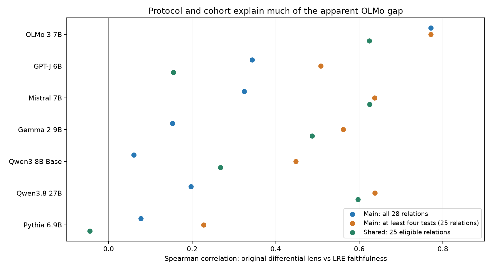
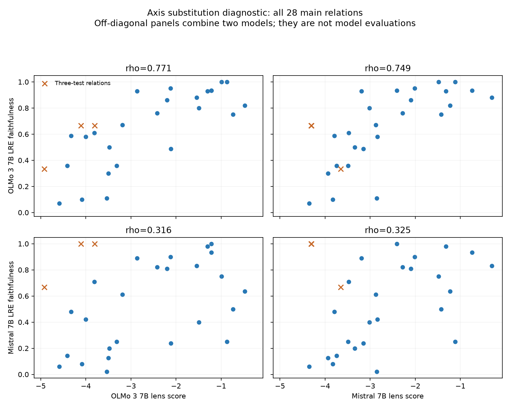

# OLMo versus other models: implementation and measurement audit

OLMo reproduces exactly in the common runner and remains strong on a fresh split. Its apparent advantage is much smaller under the shared protocol or after excluding three very small relations. A concrete Mistral gold-token labeling bug was fixed, but it does not change the model-top-1 LRE correlation. Tokenizer-dependent first-token information remains a substantive limitation of the raw metric.

The original main and shared protocols must be compared separately. The table uses original fixed lens settings and each model's independently fitted LRE. The at-least-four column changes the main cohort without changing any model settings.

| Model | Main, 28 relations | Main, at least four tests (25) | Shared, 25 relations |
| --- | --- | --- | --- |
| OLMo 3 7B | 0.771 | 0.771 | 0.624 |
| GPT-J 6B | 0.343 | 0.508 | 0.155 |
| Mistral 7B | 0.325 | 0.637 | 0.625 |
| Gemma 2 9B | 0.153 | 0.562 | 0.487 |
| Qwen3 8B Base | 0.060 | 0.448 | 0.268 |
| Qwen3.8 27B | 0.197 | 0.637 | 0.596 |
| Pythia 6.9B | 0.077 | 0.227 | -0.045 |

Qwen3.8-27B is post-trained; the other new checkpoints are base models. GPT-J main preserves the saved trailing-space year prompt variant. Shared filtering uses each tokenizer and therefore can select different subjects across models. Original data retain duplicate subjects; the separate Mistral cleaning sensitivity is not substituted into this table.

## First-token information is not equivalent

These are the actual next-token predictions for the same three main birth-year test subjects. Intercept-only agreement uses the averaged reference output with zero Jacobian contribution. A perfect score on the token `1` does not establish recovery of a full year.

| Model | Three predicted tokens | Intercept-only agreement | Selected LRE agreement |
| --- | --- | --- | --- |
| OLMo 3 7B | `178`, `188`, `177` | 0.000 | 0.667 |
| Mistral 7B | `1`, `1`, `1` | 1.000 | 1.000 |
| Gemma 2 9B | `1`, `1`, `1` | 1.000 | 1.000 |
| Qwen3 8B Base | `1`, `1`, `1` | 1.000 | 1.000 |
| Qwen3.8 27B | `1`, `1`, `1` | 1.000 | 1.000 |

## Predictor versus outcome

These crossed correlations are diagnostic only: they pair a lens from one model with faithfulness from another, so they are not performance of an actual model/LRE system.

| Model | Lens ranking vs OLMo lens | Model lens / OLMo faith | OLMo lens / model faith |
| --- | --- | --- | --- |
| GPT-J 6B | 0.612 | 0.475 | 0.469 |
| Mistral 7B | 0.839 | 0.749 | 0.316 |
| Gemma 2 9B | 0.834 | 0.654 | 0.226 |
| Qwen3 8B Base | 0.452 | 0.292 | 0.314 |
| Qwen3.8 27B | 0.851 | 0.738 | 0.231 |
| Pythia 6.9B | 0.533 | 0.447 | 0.367 |

## Paired uncertainty

The following 95% percentile intervals resample the same relations for both models (10,000 draws, seed 20260919), reranking ties within each draw. They describe the observed dataset and fixed fits, not training or subject-sampling uncertainty. They are exploratory and not adjusted for all model comparisons.

| OLMo minus model | Main gap [95% interval] | Main 25 gap [95% interval] | Shared gap [95% interval] |
| --- | --- | --- | --- |
| GPT-J 6B | 0.427 [0.116, 0.787] | 0.263 [0.021, 0.573] | 0.469 [0.061, 0.889] |
| Mistral 7B | 0.446 [0.052, 0.864] | 0.134 [-0.103, 0.426] | -0.001 [-0.418, 0.390] |
| Gemma 2 9B | 0.618 [0.140, 1.087] | 0.209 [-0.061, 0.564] | 0.137 [-0.312, 0.610] |
| Qwen3 8B Base | 0.711 [0.251, 1.123] | 0.323 [0.013, 0.686] | 0.356 [-0.156, 0.872] |
| Qwen3.8 27B | 0.574 [0.074, 1.052] | 0.134 [-0.146, 0.491] | 0.028 [-0.273, 0.350] |
| Pythia 6.9B | 0.694 [0.334, 1.030] | 0.544 [0.209, 0.903] | 0.669 [0.255, 1.057] |

## Outcome controls

Prior-normalized agreement is `(faith - intercept_only_faith)/(1 - intercept_only_faith)`. It changes the outcome definition and excludes relations with no headroom. The model-correct subset diagnostic keeps at least four correctly predicted test subjects per relation, retains the original fitted LRE/settings, and leaves the original aggregate lens score unchanged. Both are sensitivity analyses, not replacements for the primary result.

| Model | Main normalized rho (n) | Shared normalized rho (n) | Mean main intercept-only faith |
| --- | --- | --- | --- |
| OLMo 3 7B | 0.773 (28) | 0.655 (25) | 0.207 |
| GPT-J 6B | 0.514 (28) | 0.275 (25) | 0.255 |
| Mistral 7B | 0.719 (26) | 0.661 (25) | 0.266 |
| Gemma 2 9B | 0.499 (26) | 0.579 (25) | 0.257 |
| Qwen3 8B Base | 0.284 (26) | 0.412 (25) | 0.239 |
| Qwen3.8 27B | 0.569 (26) | 0.736 (25) | 0.295 |
| Pythia 6.9B | 0.220 (28) | 0.065 (25) | 0.284 |

## Fresh numerical reproduction

The common runner checked 1944 OLMo grid cells with 0 faithfulness differences and 4114 individual ranks. Rank changes are recorded in the JSON rather than discarded. Completion and fresh correlations: `{"main": {"finished": 28, "expected": 28, "correlation": {"n": 28, "rho": 0.770916242574277, "p": 1.583883678273683e-06}}, "shared_split": {"finished": 28, "expected": 28, "correlation": {"n": 25, "rho": 0.6242156872200024, "p": 0.0008533554228243768}}}`.

Frozen-setting seed-1 operator refits: `{"main": {"n": 28, "rho": 0.756538472705433, "p": 3.196270832105612e-06}, "shared_split": {"n": 25, "rho": 0.6374135837935613, "p": 0.0006100375389067702}}`. These reuse the same dataset and have overlapping subjects; no hyperparameters are selected on seed 1.

[Full analysis](analysis.json), [audit scope and interpretation](../../docs/cross-model-audit.md). The raw OLMo rerun, target/prior audits, and fresh fits are retained beside this report. Numerical gates compare HF logits, no-op interventions, scalar/batched products, finite differences, and cached/full-prompt derivatives.
