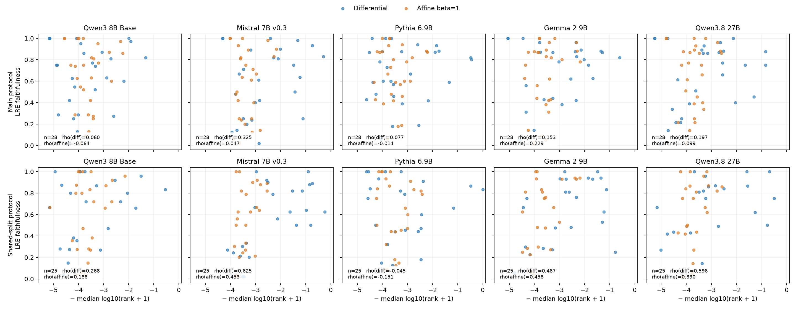

# Five-model lens/faithfulness comparison

The [all-seven-model newline rerun](../all_model_newline/README.md) reports the
same comparison with `\n{} is known for`, including OLMo and GPT-J. It contains
Spearman/Pearson values, p-values, before/after comparisons, and all affine-beta
variants. The measurements below retain the original unprefixed prompt.

Spearman correlations across relations between negative median log10(rank+1) and selected LRE faithfulness. Only complete protocol results are reported below.

| Model | Protocol | Finished / 28 | Included n | Differential rho (p) | Affine beta=1 rho (p) |
| --- | --- | --- | --- | --- | --- |
| Qwen3 8B Base | main | 28 | 28 | 0.060 (0.760) | -0.064 (0.747) |
| Qwen3 8B Base | shared_split | 28 | 25 | 0.268 (0.195) | 0.188 (0.369) |
| Mistral 7B v0.3 | main | 28 | 28 | 0.325 (0.092) | 0.047 (0.814) |
| Mistral 7B v0.3 | shared_split | 28 | 25 | 0.625 (0.001) | 0.453 (0.023) |
| Pythia 6.9B | main | 28 | 28 | 0.077 (0.696) | -0.014 (0.944) |
| Pythia 6.9B | shared_split | 28 | 25 | -0.045 (0.831) | -0.151 (0.470) |
| Gemma 2 9B | main | 28 | 28 | 0.153 (0.436) | 0.229 (0.242) |
| Gemma 2 9B | shared_split | 28 | 25 | 0.487 (0.013) | 0.458 (0.021) |
| Qwen3.8 27B | main | 28 | 28 | 0.197 (0.314) | 0.099 (0.617) |
| Qwen3.8 27B | shared_split | 28 | 25 | 0.596 (0.002) | 0.390 (0.054) |

## Sample-size sensitivity

The three main relations `name_gender`, `presidents_birth_year`, and `presidents_election_year` each have only three LRE test subjects. Removing these changes the cohort, without changing any model, LRE, or lens settings:

| Model | Main rho, all 28 | Main rho, 25 relations with at least four tests |
| --- | --- | --- |
| Qwen3 8B Base | 0.060 | 0.448 |
| Mistral 7B v0.3 | 0.325 | 0.637 |
| Pythia 6.9B | 0.077 | 0.227 |
| Gemma 2 9B | 0.153 | 0.562 |
| Qwen3.8 27B | 0.197 | 0.637 |

This is an exploratory diagnostic, not a replacement primary result. [All inspected thresholds](sample_size_sensitivity.json) and [the focused Mistral grid and fresh-split checks](../mistral_grid_search/README.md) separate cohort effects from hyperparameter tuning.

The main and shared-split protocols have different subject/reference selection. Do not interpret their difference as a controlled split-only effect.
The original dataset contains duplicate subjects: the shared split separates rows, which does not always separate subjects. The focused Mistral report includes a separate duplicate-cleaned confirmation; the table here retains the original input protocol.

Qwen3.8-27B is a post-trained hybrid model; the other four are base language models. All receive raw completion prompts. Float32, 8 references, up to 100 test subjects, six LRE layers and six beta values are retained. Affine beta tuning in the full JSON is in-sample and exploratory.

See [protocol and validation](../../docs/five-model-sweep.md), [model selection](models.json), and [checkpoint revisions](revisions.json). Per-relation JSON files retain outcomes, ranks, the full LRE grid, affine-beta sweep, split fingerprints, and pretrained numerical checks.

