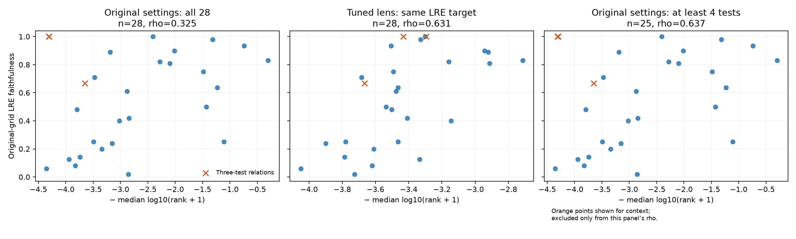
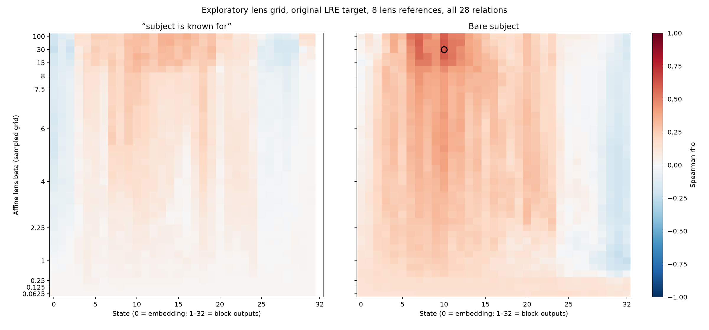

# Mistral expanded-grid results

The expanded search improves LRE fitting. Small test sets, trivial first-token targets, and repeated subjects also affect the correlation. On cleaned seed-1 shared inputs, frozen expanded LRE settings with the original lens reach rho=0.761 versus 0.665 for the original LRE settings. The large gains from tuning the lens do not reproduce consistently. All searched maxima are exploratory.

| Main protocol, all 28 relations | Spearman rho |
| --- | --- |
| Original LRE and original lens | 0.325 |
| All usable LRE states and continuous positive beta; original lens | 0.357 |
| Original LRE; best searched lens | 0.631 |
| Expanded LRE; best searched lens | 0.578 |

The original-target winner is the bare-subject affine lens, state 10, lens beta=30, eight references. The expanded-target winner is bare-subject affine, state 8, lens beta=30, four lens references (eight LRE references). LRE beta and lens beta are separate parameters.

The three relations `name_gender`, `presidents_birth_year`, and `presidents_election_year` each have only three LRE test subjects. Both year relations have an intercept-only first-token faithfulness of 1. The unchanged original method has rho=0.637 on the 25 relations with at least four tests; this is a changed-cohort sensitivity, not the all-28 result.

| Minimum LRE test subjects (unchanged original method) | Relations | rho |
| --- | --- | --- |
| 1 | 28 | 0.325 |
| 4 | 25 | 0.637 |
| 10 | 21 | 0.722 |
| 20 | 17 | 0.691 |
| 50 | 16 | 0.688 |
| 100 | 13 | 0.687 |

## Selection checks

Selecting the lens on 14 predefined relations and evaluating on the other 14 gives rho=0.002 with the original LRE target and rho=-0.213 with the expanded target. The configurations selected on the training relations differ from the full-data winners. Model choice itself used earlier full-data results.

The 2,000-permutation maximum-over-grid diagnostic gives adjusted p=0.0325 for the original target and p=0.0855 for the expanded target. This adjustment is conditional on the chosen model and LRE target; it does not cover every research choice.

| Frozen configuration, fresh seed-1 operator fit | Original-grid LRE rho | Expanded LRE rho |
| --- | --- | --- |
| baseline | 0.387 | 0.479 |
| exploratory_winner | -0.132 | 0.018 |
| original_target_winner | 0.286 | 0.427 |
| calibration_target_winner | 0.350 | 0.474 |
| relation_selection_winner | 0.377 | 0.476 |
| calibration_relation_selection_winner | 0.342 | 0.491 |

Hyperparameters were frozen before this draw. Demonstrations/references changed and operators were refitted. Some subjects overlap across draws; this is a same-dataset robustness check.
The main-protocol lens winner did not improve correlation on this fresh draw. Keeping the original lens while expanding the LRE fit improved correlation on both draws; the much larger in-sample lens gain did not reproduce.

## Shared-split protocol

Original fixed lens/original LRE: rho=0.625. Expanded LRE with the fixed lens: rho=0.710. Best exploratory expanded-target lens: rho=0.761. These use the shared protocol’s eligible relations and aligned subject/reference sets, not the main protocol’s 28-relation cohort.

| Shared split, frozen settings and fresh seed-1 fit | Original-grid LRE rho | Expanded LRE rho |
| --- | --- | --- |
| baseline | 0.681 | 0.673 |
| exploratory_winner | 0.542 | 0.585 |
| original_target_winner | 0.664 | 0.713 |
| relation_selection_winner | 0.603 | 0.625 |
| calibration_relation_selection_winner | 0.587 | 0.633 |

This confirmation also freezes the lens and per-relation LRE hyperparameters before refitting on seed 1. It remains a same-dataset check with overlapping subjects. See [shared confirmation](analysis/shared_confirmation.json) for sample counts and all settings.
The shared expanded-target winner also falls below the original lens on this draw (0.585 versus 0.673). Expanded LRE fitting is not uniformly better: the fixed lens with original-grid LRE settings reaches 0.681 on this draw.

## Subject-duplicate sensitivity

The input audit found repeated subjects in nine relations, including subjects with multiple gold objects. Row-wise partitioning does not guarantee subject-disjoint partitions: for example, the original main superhero relation shares three subjects between references and tests; the shared product relation shares one. This is separate from the intended main lens/LRE split difference.

A further seed-1 check collapses identical subject/object rows and removes subjects with multiple gold objects before splitting. All hyperparameters remain frozen. Because cleaning changes the shuffled pool, demonstrations, references, and tests can all change; this is a data-cleaning sensitivity, not an isolated estimate of leakage bias. Identical effective pools reuse their existing seed-1 measurements.

| Cleaned seed-1 inputs | Original LRE, original lens | Expanded LRE, original lens | Expanded LRE, selected lens |
| --- | --- | --- | --- |
| main (n=28) | 0.280 | 0.471 | 0.103 |
| shared_split (n=25) | 0.665 | 0.761 | 0.572 |

[Input and overlap audit](analysis/input_subject_audit.json), [clean main results](analysis/clean_main.json), [clean shared results](analysis/clean_shared_split.json). Original protocol results remain above for comparability.

## Controls and artifacts

Subtracting the intercept-only predictor and normalizing by remaining headroom gives the original lens rho=0.719 on 26 relations; the two year relations have zero headroom. This is an exploratory alternative outcome, not the original raw faithfulness metric. The matched-prediction rank/faithfulness control has rho=0.830, but shares predictions and targets and is not independent lens evidence.

The search covers state 0 and all 32 block outputs, 41 finite beta values, continuous positive LRE beta, 4/8 references, differential/affine readouts, two neutral prompts, both protocols, and five rank summaries. Median log-rank is primary; other summaries are sensitivity analyses. Degenerate constant-direction readouts and beta-zero controls are not promoted as improvements.

[Protocol and remaining factors](../../docs/mistral-grid-search.md). [Main analysis](analysis/main.json), [factor diagnostics](analysis/diagnostics_main.json), [configuration](config.json), [preassigned relation folds](relation_folds.json). Compressed per-relation scoring records are under `raw/`; the larger derivative-product tensors remain in `generated/mistral_full_grid/` for reuse.

