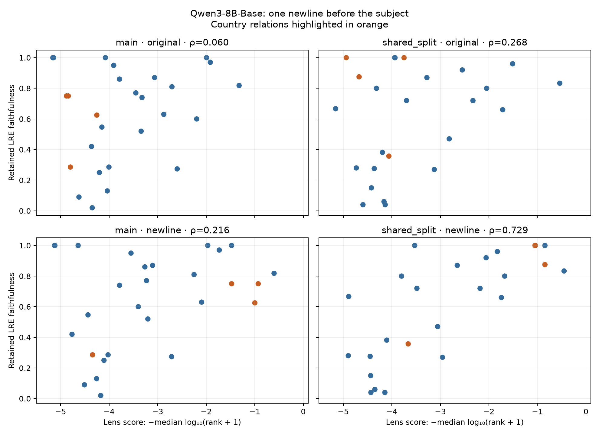

# Qwen3-8B-Base: complete newline-prefix rerun

The neutral lens prompt is now `\n{} is known for`. This rerun covers every previously eligible relation in both protocols, with the original checkpoint, state 19, float32/eager attention, splits, references, target tokens, and LRE faithfulness. No layer or beta was retuned. Only the neutral lens prompt changed.

The runner verifies that prepending the newline preserves every original token ID after one added token, checks subject offsets, and requires identical subject/target/reference-count rows and split fingerprints. The report checks complete cohorts, source/data hashes, and recalculates rank aggregates from the individual rows.

Score: negative median log10(target rank + 1). Correlations are across relations against retained LRE model-top-1 faithfulness, not gold-answer accuracy.

| Protocol | Relations | Original Spearman ρ | Newline Spearman ρ | Newline p | Δρ, paired 95% CI |
| --- | ---: | ---: | ---: | ---: | --- |
| main | 28 | 0.0604 | 0.2158 | 0.2702 | +0.1554 [-0.0619, +0.4017] |
| shared_split | 25 | 0.2680 | 0.7291 | 3.564e-05 | +0.4611 [+0.0969, +0.8492] |



The existing sensitivity excluding relations with fewer than four LRE tests:

- main: ρ 0.4483 → 0.6442, p=0.00051, 25 relations.
- shared_split: ρ 0.2699 → 0.7591, p=1.707e-05, 24 relations.

Country capital predictions (zero-based ranks of the original target token):

| Country | Target | Original rank | Newline rank | Newline top five |
| --- | --- | ---: | ---: | --- |
| Australia | Canberra | 22182 | 18 | `澳洲`, `Aussie`, `Australian`, `澳大利亚`, `Australians` |
| Argentina | Buenos | 55413 | 3 | `阿根廷`, `Argentine`, `Argentina`, `Buenos`, `Argentina` |
| Egypt | Cairo | 14475 | 6 | `埃及`, `Egyptian`, `Egypt`, `Egyptians`, `Egypt` |
| Peru | Lima | 11 | 3 | `Peru`, `Ecuador`, `peru`, `Lima`, `Bolivia` |
| Japan | Tokyo | 97274 | 1 | `Japanese`, `Tokyo`, `Japanese`, `Japan`, `japon` |
| United States | Washington | 43 | 317 | `NAFTA`, `美军`, `Guantanamo`, `Americans`, `芝加哥` |
| China | Beijing | 77252 | 12 | `Mandarin`, `Alibaba`, `Chinese`, `China`, `对中国` |
| Brazil | Bras | 147047 | 51 | `巴西`, `Brazilian`, `Brazil`, `Brazil`, `brazil` |
| Venezuela | Car | 11086 | 9397 | `Venezuelan`, `Venezuela`, `Maduro`, `Venezuel`, `venez` |
| India | New | 134784 | 94538 | `Bollywood`, `Hindu`, `Hindus`, `Indian`, `Indians` |
| Chile | Santiago | 10 | 10 | `Chile`, `Chili`, `Oregon`, `copper`, `salmon` |
| Saudi Arabia | Riyadh | 1 | 7 | `Saudi`, `沙特`, `Saudi`, `沙漠`, `Saudis` |
| Germany | Berlin | 123010 | 11 | `Germany`, `Germans`, `德国`, `Germany`, `ドイツ` |
| Spain | Madrid | 92610 | 7 | `Spain`, `西班牙`, `Catalonia`, `Barcelona`, `Sevilla` |
| Russia | Moscow | 9270 | 8 | `Putin`, `Kremlin`, `Russians`, `中俄`, `普京` |
| South Korea | Seoul | 1 | 3 | `是韩国`, `Korean`, `Samsung`, `Seoul`, `Koreans` |

The newline removes the diagnosed first-position mismatch. These are revised measurements following that diagnosis, not independent held-out confirmation. The two protocols are not independent replications; retained LRE faithfulness still uses in-sample layer/beta selection. The relation bootstrap uses 10,000 paired draws (seed 20260921); relations share subjects and domains, so its intervals are approximate. Tiny relations and first-token target ambiguity remain.

Raw per-subject outputs are in `main/newline_known_for/` and `shared_split/newline_known_for/`. `summary.json` includes validation metadata, counts, excluded relations, and both differential and affine correlations. `relation_scores.csv` and `correlations.csv` retain unrounded values.

Reproduce from `code/` (four workers can share the output directory on separate GPUs):

```sh
CUDA_VISIBLE_DEVICES=0 .venv/bin/python scripts/run_qwen_prompt_sensitivity.py --root results/qwen_newline_rerun --prompts newline_known_for --batch-size 8 --worker 0
.venv/bin/python scripts/report_qwen_newline_rerun.py
```
